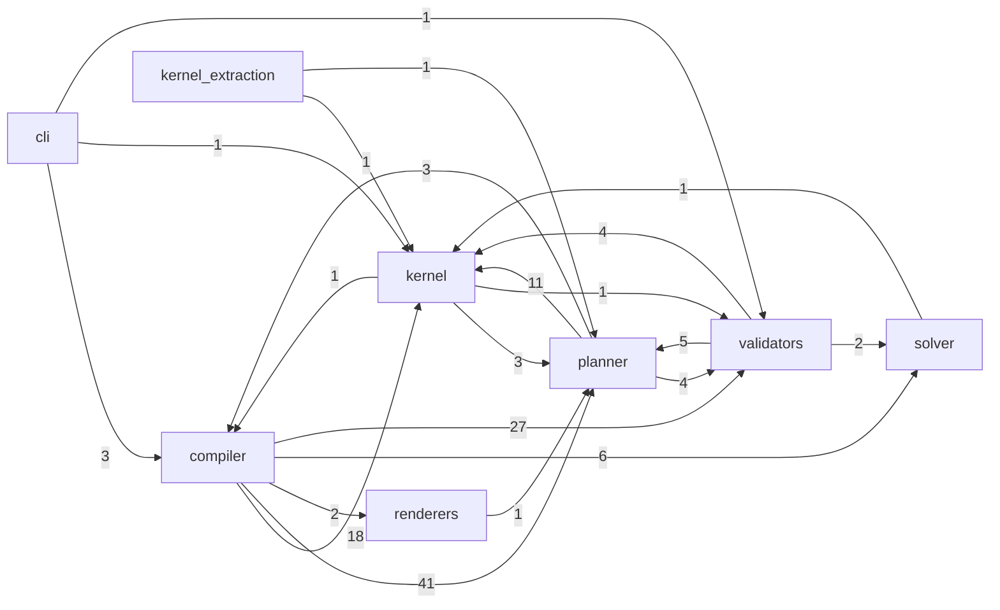

# Code dependencies

Generated by `python -m kernel.build_docs` from the import statements. Do not edit by hand.

## External packages

- Runtime: `pyyaml>=6.0` (Python >=3.11)
- Development: `pytest>=8`, `ruff>=0.6`
- Console script: `cinematic` → `cli.main:main`

## Package graph

Arrow = imports (count of module-level imports).

## Modules

| Module | Imports (internal) | Imports (standard library / external) |
|---|---|---|
| `cli.main` | `compiler.authoring`, `compiler.pipeline`, `compiler.replan_trigger`, `kernel.canonical`, `validators.envelope_validator` | argparse, json, pathlib, sys |
| `compiler.authoring` | `kernel.canonical`, `planner.dependency_graph`, `validators.layer_dependency_validator`, `validators.schema_validator` | copy, json |
| `compiler.examples` | `compiler.pipeline`, `kernel.canonical`, `kernel.kernel_files`, `planner.dependency_graph` | json, sys |
| `compiler.passes.derived.p08_hand_role` | `compiler.authoring`, `compiler.passes.mandatory.p07_contact`, `planner.dependency_graph`, `planner.library_vocab`, `validators.schema_validator` | json, yaml |
| `compiler.passes.derived.p09_object_state` | `compiler.authoring`, `compiler.passes.mandatory.p07_contact`, `kernel.canonical`, `planner.dependency_graph`, `validators.layer_dependency_validator`, `validators.schema_validator` | copy, json |
| `compiler.passes.derived.p10_affordance` | `compiler.authoring`, `kernel.canonical`, `planner.dependency_graph`, `validators.layer_dependency_validator`, `validators.schema_validator` | copy, functools, json, yaml |
| `compiler.passes.derived.p11_kinematic` | `compiler.authoring`, `planner.dependency_graph`, `planner.library_vocab`, `planner.scene_view` | — |
| `compiler.passes.derived.p12_bartenieff` | `compiler.authoring`, `planner.dependency_graph`, `planner.library_vocab`, `planner.scene_view`, `validators.schema_validator` | json, yaml |
| `compiler.passes.derived.p13_motion` | `compiler.authoring`, `kernel.kernel_files`, `planner.dependency_graph`, `planner.scene_view`, `solver.euler_solver`, `solver.quaternion`, `solver.trajectory` | — |
| `compiler.passes.derived.p14_facial` | `compiler.authoring`, `planner.dependency_graph`, `planner.scene_view`, `solver.quaternion`, `validators.facial_validator`, `validators.schema_validator` | functools, json, yaml |
| `compiler.passes.derived.p15_effort` | `compiler.authoring`, `planner.dependency_graph`, `planner.library_vocab`, `planner.scene_view`, `validators.schema_validator` | json, yaml |
| `compiler.passes.derived.p16_camera` | `compiler.authoring`, `planner.camera_library`, `planner.dependency_graph`, `planner.library_vocab`, `solver.camera_geometry`, `validators.camera_validator` | — |
| `compiler.passes.derived.p17_render` | `compiler.authoring`, `planner.dependency_graph`, `renderers.anime_renderer`, `renderers.ugc_renderer` | — |
| `compiler.passes.mandatory.p01_intent` | `kernel.canonical`, `planner.dependency_graph`, `planner.intent_parser`, `validators.layer_dependency_validator`, `validators.schema_validator` | copy, json |
| `compiler.passes.mandatory.p02_brief` | `kernel.canonical`, `planner.dependency_graph`, `planner.query_expander`, `validators.layer_dependency_validator`, `validators.schema_validator` | copy, json |
| `compiler.passes.mandatory.p03_constraint` | `kernel.canonical`, `planner.card_loader`, `planner.dependency_graph`, `validators.layer_dependency_validator`, `validators.schema_validator` | copy, json, yaml |
| `compiler.passes.mandatory.p04_temporal` | `compiler.authoring`, `kernel.canonical`, `planner.beat_planner`, `planner.dependency_graph`, `planner.dynamic_beat_validator`, `validators.layer_dependency_validator`, `validators.schema_validator` | copy, json |
| `compiler.passes.mandatory.p05_causal` | `compiler.authoring`, `kernel.canonical`, `planner.dependency_graph`, `validators.layer_dependency_validator`, `validators.schema_validator` | copy, json |
| `compiler.passes.mandatory.p06_state` | `compiler.authoring`, `kernel.canonical`, `kernel.kernel_files`, `planner.dependency_graph`, `planner.vocabulary`, `solver.prop_state_machine`, `validators.continuity_validator`, `validators.layer_dependency_validator`, `validators.schema_validator` | copy, json |
| `compiler.passes.mandatory.p07_contact` | `compiler.authoring`, `kernel.canonical`, `planner.dependency_graph`, `validators.layer_dependency_validator`, `validators.schema_validator` | copy, json |
| `compiler.pipeline` | `compiler.authoring`, `compiler.passes.derived.p08_hand_role`, `compiler.passes.derived.p09_object_state`, `compiler.passes.derived.p10_affordance`, `compiler.passes.derived.p11_kinematic`, `compiler.passes.derived.p12_bartenieff`, `compiler.passes.derived.p13_motion`, `compiler.passes.derived.p14_facial`, `compiler.passes.derived.p15_effort`, `compiler.passes.derived.p16_camera`, `compiler.passes.derived.p17_render`, `compiler.passes.mandatory.p01_intent`, `compiler.passes.mandatory.p02_brief`, `compiler.passes.mandatory.p03_constraint`, `compiler.passes.mandatory.p04_temporal`, `compiler.passes.mandatory.p05_causal`, `compiler.passes.mandatory.p06_state`, `compiler.passes.mandatory.p07_contact`, `kernel.canonical`, `kernel.kernel_files`, `kernel.version`, `planner.dependency_graph`, `planner.intent_parser`, `planner.topological_sort` | argparse, importlib, json, pathlib, subprocess, sys, time |
| `compiler.replan_trigger` | `compiler.authoring`, `kernel.canonical`, `planner.dependency_graph`, `planner.topological_sort` | — |
| `kernel.build_docs` | `compiler.pipeline`, `planner.dependency_graph`, `planner.topological_sort` | ast, json, re, sys, tomllib, yaml |
| `kernel.build_ir_schema` | `kernel.version`, `planner.dependency_graph` | json, sys |
| `kernel.canonical` | — | hashlib, json, math |
| `kernel.kernel_files` | `validators.schema_validator` | hashlib, json, pathlib, yaml |
| `kernel.schema_log` | `kernel.canonical`, `kernel.version` | argparse, datetime, hashlib, json, pathlib, yaml |
| `kernel.version` | — | — |
| `kernel_extraction.control_inventory` | `kernel.canonical`, `planner.dependency_graph` | hashlib, json, re, sys, yaml |
| `planner.archetype_resolver` | — | — |
| `planner.beat_planner` | `compiler.authoring`, `kernel.kernel_files`, `planner.dependency_graph`, `planner.modality`, `planner.vocabulary` | — |
| `planner.camera_library` | `planner.dependency_graph`, `validators.schema_validator` | functools, json, yaml |
| `planner.card_loader` | `kernel.canonical`, `planner.dependency_graph`, `validators.schema_validator` | json, re, yaml |
| `planner.chaining` | `compiler.passes.mandatory.p07_contact`, `kernel.canonical`, `kernel.kernel_files` | — |
| `planner.dependency_graph` | `kernel.canonical` | pathlib, yaml |
| `planner.dynamic_beat_validator` | `planner.vocabulary` | — |
| `planner.entity_grounder` | — | — |
| `planner.intent_parser` | `kernel.canonical` | argparse, re, sys |
| `planner.library_vocab` | `planner.dependency_graph`, `validators.schema_validator` | functools, json, yaml |
| `planner.modality` | `kernel.canonical`, `planner.dependency_graph`, `validators.schema_validator` | functools, json |
| `planner.query_expander` | `kernel.canonical`, `kernel.kernel_files`, `planner.archetype_resolver`, `planner.card_loader`, `planner.chaining`, `planner.entity_grounder`, `planner.intent_parser`, `planner.modality`, `planner.world_grounder` | argparse, sys |
| `planner.scene_view` | `compiler.passes.mandatory.p07_contact` | — |
| `planner.topological_sort` | `kernel.canonical`, `planner.dependency_graph` | — |
| `planner.vocabulary` | `kernel.kernel_files` | — |
| `planner.world_grounder` | `planner.card_loader` | — |
| `renderers.anime_renderer` | `planner.library_vocab` | hashlib, json, math |
| `renderers.ugc_renderer` | `renderers.anime_renderer` | — |
| `solver.camera_geometry` | — | math |
| `solver.euler_solver` | `solver.quaternion` | — |
| `solver.prop_state_machine` | — | — |
| `solver.quaternion` | `kernel.canonical` | math |
| `solver.trajectory` | — | math |
| `validators.camera_validator` | `planner.library_vocab`, `solver.camera_geometry` | — |
| `validators.continuity_validator` | `solver.prop_state_machine` | — |
| `validators.envelope_validator` | `kernel.kernel_files`, `planner.dependency_graph`, `planner.modality`, `validators.layer_dependency_validator`, `validators.schema_validator` | json |
| `validators.facial_validator` | — | json, re |
| `validators.layer_dependency_validator` | `kernel.canonical`, `kernel.version`, `planner.dependency_graph`, `planner.topological_sort` | re |
| `validators.schema_validator` | `kernel.canonical` | re |
