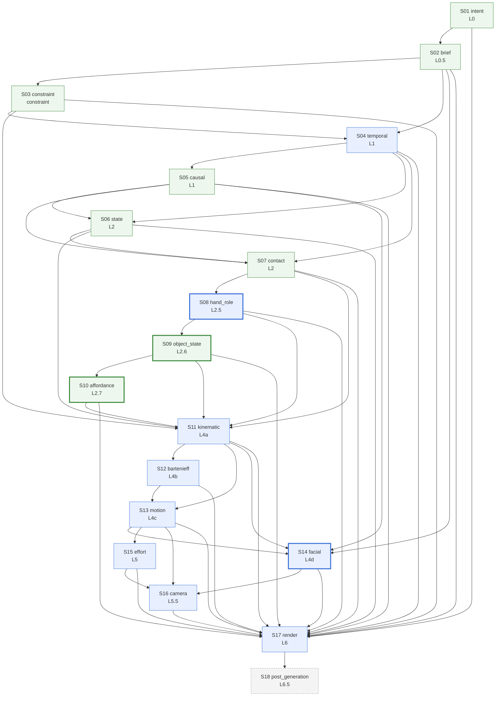

# Dependencies — the layer DAG

Generated by `python -m kernel.build_docs` from `kernel/layer_order.yaml` and the step modules. Do not edit by hand.

## Step graph

Arrows point from an input step to the step that reads it. Authored steps are written in-session from a sealed packet; derived steps are computed; steps that run only for some genres have a thick border; S18 not built yet. Every step also reads `kernel/layer_order.yaml` (its owner tags and write scope).

## Steps

| Step | Node | Band | Builds | Kind | Runs for | Depends on | Writes | Validated by | Code | Authored plan schema | Prompt | Data read (library / kernel) |
|---|---|---|---|---|---|---|---|---|---|---|---|---|
| S01 | intent | L0 | Intent Document | derived | all | — | `/intent` | schema | [compiler/passes/mandatory/p01_intent.py](../../compiler/passes/mandatory/p01_intent.py) | — | — | — |
| S02 | brief | L0.5 | Expanded brief (entity, prop and surface definitions; world grounding) | derived | all | intent | `/scene` `/nodes/entities` `/nodes/props` `/nodes/surfaces` | schema, coherence | [compiler/passes/mandatory/p02_brief.py](../../compiler/passes/mandatory/p02_brief.py) | — | — | [kernel/conventions.yaml](../../kernel/conventions.yaml) [library/archetypes](../../library/archetypes) [library/ontology/objects](../../library/ontology/objects) [library/worlds](../../library/worlds) |
| S03 | constraint | constraint | Constraint graph (kernel + world + archetype invariants) | derived | all | brief | `/nodes/constraints` `/edges/constraint_application` `/invariants` | schema | [compiler/passes/mandatory/p03_constraint.py](../../compiler/passes/mandatory/p03_constraint.py) | — | — | [kernel/invariants.yaml](../../kernel/invariants.yaml) [library/archetypes](../../library/archetypes) [library/ontology/objects](../../library/ontology/objects) [library/worlds](../../library/worlds) |
| S04 | temporal | L1 | Temporal graph (authored beat plan) | authored | all | brief, constraint | `/nodes/beats` `/edges/temporal` `/edges/beat_constraint` `/scene/duration_s` `/scene/duration_source` | schema, invariants, constraint | [compiler/passes/mandatory/p04_temporal.py](../../compiler/passes/mandatory/p04_temporal.py) | [schemas/graphs/beat_plan.schema.json](../../schemas/graphs/beat_plan.schema.json) | [planner/prompts/beat_planning.txt](../../planner/prompts/beat_planning.txt) | [kernel/state_vocabulary.yaml](../../kernel/state_vocabulary.yaml) [library/body_segments.yaml](../../library/body_segments.yaml) [library/combat_verbs.yaml](../../library/combat_verbs.yaml) |
| S05 | causal | L1 | Causal graph and scene quadrant | derived | all | temporal | `/edges/causal` `/scene/quadrant` | schema, invariants, constraint | [compiler/passes/mandatory/p05_causal.py](../../compiler/passes/mandatory/p05_causal.py) | — | — | — |
| S06 | state | L2 | State graph (state tracks of L0.5 definitions) | derived | all | temporal, causal | `/nodes/states` `/edges/state_transition` | schema, invariants, constraint | [compiler/passes/mandatory/p06_state.py](../../compiler/passes/mandatory/p06_state.py) | — | — | [kernel/state_vocabulary.yaml](../../kernel/state_vocabulary.yaml) |
| S07 | contact | L2 | Contact graph | derived | all | temporal, causal, state | `/nodes/contacts` `/edges/contact` | schema, invariants, constraint | [compiler/passes/mandatory/p07_contact.py](../../compiler/passes/mandatory/p07_contact.py) | — | — | — |
| S08 | hand_role | L2.5 | Hand-role graph | authored | ugc_ad | contact | `/nodes/hand_role` `/edges/hand_role_transition` | schema, invariants, constraint | [compiler/passes/derived/p08_hand_role.py](../../compiler/passes/derived/p08_hand_role.py) | [schemas/graphs/hand_role_plan.schema.json](../../schemas/graphs/hand_role_plan.schema.json) | [planner/prompts/hand_roles.txt](../../planner/prompts/hand_roles.txt) | [library/grip_types.yaml](../../library/grip_types.yaml) [library/role_templates.yaml](../../library/role_templates.yaml) |
| S09 | object_state | L2.6 | Object-state graph | derived | ugc_ad | hand_role | `/nodes/object_state` `/edges/object_state_transition` | schema, invariants, constraint | [compiler/passes/derived/p09_object_state.py](../../compiler/passes/derived/p09_object_state.py) | — | — | — |
| S10 | affordance | L2.7 | Affordance graph | derived | ugc_ad | object_state | `/nodes/affordance` `/edges/affordance_dependency` | schema, invariants, constraint | [compiler/passes/derived/p10_affordance.py](../../compiler/passes/derived/p10_affordance.py) | — | — | [library/affordances](../../library/affordances) |
| S11 | kinematic | L4a | Kinematic graph (visible bodily organization) | authored | all | state, contact, hand_role, object_state, affordance, constraint | `/nodes/kinematic` `/edges/kinematic_transition` | schema, invariants, constraint | [compiler/passes/derived/p11_kinematic.py](../../compiler/passes/derived/p11_kinematic.py) | [schemas/graphs/kinematic_plan.schema.json](../../schemas/graphs/kinematic_plan.schema.json) | [planner/prompts/kinematic_organization.txt](../../planner/prompts/kinematic_organization.txt) | [kernel/state_vocabulary.yaml](../../kernel/state_vocabulary.yaml) [library/kinematic_cues.yaml](../../library/kinematic_cues.yaml) |
| S12 | bartenieff | L4b | Bartenieff graph (body coordination patterns) | authored | all | kinematic | `/nodes/bartenieff` `/edges/bartenieff_transition` | schema, invariants, constraint | [compiler/passes/derived/p12_bartenieff.py](../../compiler/passes/derived/p12_bartenieff.py) | [schemas/graphs/bartenieff_plan.schema.json](../../schemas/graphs/bartenieff_plan.schema.json) | [planner/prompts/body_coordination.txt](../../planner/prompts/body_coordination.txt) | [library/bartenieff_vocabulary.yaml](../../library/bartenieff_vocabulary.yaml) [library/body_modes](../../library/body_modes) |
| S13 | motion | L4c | Motion graph (Euler key poses, axes, slerp, root trajectories) | authored | all | kinematic, bartenieff | `/nodes/motion` `/edges/motion` | schema, invariants, constraint | [compiler/passes/derived/p13_motion.py](../../compiler/passes/derived/p13_motion.py) | [schemas/graphs/motion_plan.schema.json](../../schemas/graphs/motion_plan.schema.json) | [planner/prompts/euler_solving.txt](../../planner/prompts/euler_solving.txt) | [kernel/contact_world_exceptions.yaml](../../kernel/contact_world_exceptions.yaml) [kernel/invariants.yaml](../../kernel/invariants.yaml) [library/body_segments.yaml](../../library/body_segments.yaml) [library/genre_profiles](../../library/genre_profiles) [library/joint_limits.yaml](../../library/joint_limits.yaml) |
| S14 | facial | L4d | Facial graph (FACS action units, valence/arousal, salience per entity per beat) | authored | live_action, ugc_ad | brief, causal, kinematic, motion | `/nodes/facial` `/edges/facial_transition` | schema, invariants, constraint | [compiler/passes/derived/p14_facial.py](../../compiler/passes/derived/p14_facial.py) | [schemas/graphs/facial_plan.schema.json](../../schemas/graphs/facial_plan.schema.json) | [planner/prompts/facial_acting.txt](../../planner/prompts/facial_acting.txt) | — |
| S15 | effort | L5 | Effort graph (LMA Effort factors plus Shape and Space) | authored | all | motion | `/nodes/efforts` `/edges/effort` | schema, invariants, constraint | [compiler/passes/derived/p15_effort.py](../../compiler/passes/derived/p15_effort.py) | [schemas/graphs/effort_plan.schema.json](../../schemas/graphs/effort_plan.schema.json) | [planner/prompts/laban_synthesis.txt](../../planner/prompts/laban_synthesis.txt) | [library/effort_modes](../../library/effort_modes) [library/laban_vocabulary.yaml](../../library/laban_vocabulary.yaml) |
| S16 | camera | L5.5 | Camera graph (13 subdivisions + motivation) | authored | all | motion, effort, facial | `/nodes/camera` `/edges/camera` | schema, invariants, constraint, camera_rules | [compiler/passes/derived/p16_camera.py](../../compiler/passes/derived/p16_camera.py) | [schemas/graphs/camera_plan.schema.json](../../schemas/graphs/camera_plan.schema.json) | [planner/prompts/camera_selection.txt](../../planner/prompts/camera_selection.txt) | [library/camera_conventions](../../library/camera_conventions) [library/camera_grammar.yaml](../../library/camera_grammar.yaml) [library/camera_idioms](../../library/camera_idioms) [library/camera_subdivisions.yaml](../../library/camera_subdivisions.yaml) [library/camera_tempo.yaml](../../library/camera_tempo.yaml) |
| S17 | render | L6 | Prose / render projection (full LBN layout, uncompressed) | authored · projection | all | intent, brief, temporal, causal, state, contact, hand_role, object_state, affordance, constraint, kinematic, bartenieff, motion, facial, effort, camera | `/nodes/render` | schema, invariants, constraint | [compiler/passes/derived/p17_render.py](../../compiler/passes/derived/p17_render.py) | [schemas/graphs/frame_parts_plan.schema.json](../../schemas/graphs/frame_parts_plan.schema.json) | [planner/prompts/frame_parts.txt](../../planner/prompts/frame_parts.txt) | [kernel/contact_world_exceptions.yaml](../../kernel/contact_world_exceptions.yaml) [library/bartenieff_vocabulary.yaml](../../library/bartenieff_vocabulary.yaml) [library/camera_conventions](../../library/camera_conventions) [library/camera_grammar.yaml](../../library/camera_grammar.yaml) [library/camera_idioms](../../library/camera_idioms) [library/camera_tempo.yaml](../../library/camera_tempo.yaml) [library/laban_vocabulary.yaml](../../library/laban_vocabulary.yaml) |
| S18 | post_generation | L6.5 | Post-generation report (only when a video model is available) | not built (M7) | all | render | `/validation/post_generation` | pose, object, state, affordance | — | — | — | — |

## Build order per genre

- **live_action** (15 steps): S01 intent → S02 brief → S03 constraint → S04 temporal → S05 causal → S06 state → S07 contact → S11 kinematic → S12 bartenieff → S13 motion → S14 facial → S15 effort → S16 camera → S17 render → S18 post_generation
- **anime** (14 steps): S01 intent → S02 brief → S03 constraint → S04 temporal → S05 causal → S06 state → S07 contact → S11 kinematic → S12 bartenieff → S13 motion → S15 effort → S16 camera → S17 render → S18 post_generation
- **ugc_ad** (18 steps): S01 intent → S02 brief → S03 constraint → S04 temporal → S05 causal → S06 state → S07 contact → S08 hand_role → S09 object_state → S10 affordance → S11 kinematic → S12 bartenieff → S13 motion → S14 facial → S15 effort → S16 camera → S17 render → S18 post_generation

## Write ownership

Every envelope path has exactly one owner; an inner path (carve-out) is owned by a later step and the outer owner never touches it.

| Path | Owner |
|---|---|
| `/derived_from` | pipeline |
| `/edges/affordance_dependency` | S10 affordance |
| `/edges/bartenieff_transition` | S12 bartenieff |
| `/edges/beat_constraint` | S04 temporal |
| `/edges/camera` | S16 camera |
| `/edges/causal` | S05 causal |
| `/edges/constraint_application` | S03 constraint |
| `/edges/contact` | S07 contact |
| `/edges/effort` | S15 effort |
| `/edges/facial_transition` | S14 facial |
| `/edges/hand_role_transition` | S08 hand_role |
| `/edges/kinematic_transition` | S11 kinematic |
| `/edges/motion` | S13 motion |
| `/edges/object_state_transition` | S09 object_state |
| `/edges/state_transition` | S06 state |
| `/edges/temporal` | S04 temporal |
| `/graph_version` | pipeline |
| `/intent` | S01 intent |
| `/invariants` | S03 constraint |
| `/nodes/affordance` | S10 affordance |
| `/nodes/bartenieff` | S12 bartenieff |
| `/nodes/beats` | S04 temporal |
| `/nodes/camera` | S16 camera |
| `/nodes/constraints` | S03 constraint |
| `/nodes/contacts` | S07 contact |
| `/nodes/efforts` | S15 effort |
| `/nodes/entities` | S02 brief |
| `/nodes/facial` | S14 facial |
| `/nodes/hand_role` | S08 hand_role |
| `/nodes/kinematic` | S11 kinematic |
| `/nodes/motion` | S13 motion |
| `/nodes/object_state` | S09 object_state |
| `/nodes/props` | S02 brief |
| `/nodes/render` | S17 render |
| `/nodes/states` | S06 state |
| `/nodes/surfaces` | S02 brief |
| `/provenance` | pipeline |
| `/scene` | S02 brief |
| `/scene/duration_s` | S04 temporal |
| `/scene/duration_source` | S04 temporal |
| `/scene/quadrant` | S05 causal |
| `/validation/camera_kinematic_coupling` | pipeline |
| `/validation/invariants` | pipeline |
| `/validation/layer_dependency` | pipeline |
| `/validation/post_generation` | S18 post_generation |
| `/validation/schema` | pipeline |

## Node and edge groups

| Group | Kind | Written by | Edge endpoints (from → to) |
|---|---|---|---|
| `entities` | node | S02 brief |  |
| `props` | node | S02 brief |  |
| `surfaces` | node | S02 brief |  |
| `constraints` | node | S03 constraint |  |
| `constraint_application` | edge | S03 constraint | constraints → scene, entities, props |
| `beats` | node | S04 temporal |  |
| `temporal` | edge | S04 temporal | beats → beats |
| `beat_constraint` | edge | S04 temporal | beats → constraints |
| `causal` | edge | S05 causal | beats → beats |
| `states` | node | S06 state |  |
| `state_transition` | edge | S06 state | states → states |
| `contacts` | node | S07 contact |  |
| `contact` | edge | S07 contact | contacts → contacts |
| `hand_role` | node | S08 hand_role |  |
| `hand_role_transition` | edge | S08 hand_role | hand_role → hand_role |
| `object_state` | node | S09 object_state |  |
| `object_state_transition` | edge | S09 object_state | object_state → object_state |
| `affordance` | node | S10 affordance |  |
| `affordance_dependency` | edge | S10 affordance | affordance → affordance |
| `kinematic` | node | S11 kinematic |  |
| `kinematic_transition` | edge | S11 kinematic | kinematic → kinematic |
| `bartenieff` | node | S12 bartenieff |  |
| `bartenieff_transition` | edge | S12 bartenieff | bartenieff → bartenieff |
| `motion` | node | S13 motion |  |
| `motion` | edge | S13 motion | motion → motion |
| `facial` | node | S14 facial |  |
| `facial_transition` | edge | S14 facial | facial → facial |
| `efforts` | node | S15 effort |  |
| `effort` | edge | S15 effort | efforts → efforts |
| `camera` | node | S16 camera |  |
| `camera` | edge | S16 camera | camera → camera |
| `render` | node | S17 render |  |

17 node groups, 15 edge groups.

## Steps active per genre

| Step | live_action | anime | ugc_ad |
|---|---|---|---|
| S01 intent | yes | yes | yes |
| S02 brief | yes | yes | yes |
| S03 constraint | yes | yes | yes |
| S04 temporal | yes | yes | yes |
| S05 causal | yes | yes | yes |
| S06 state | yes | yes | yes |
| S07 contact | yes | yes | yes |
| S08 hand_role | — | — | yes |
| S09 object_state | — | — | yes |
| S10 affordance | — | — | yes |
| S11 kinematic | yes | yes | yes |
| S12 bartenieff | yes | yes | yes |
| S13 motion | yes | yes | yes |
| S14 facial | yes | — | yes |
| S15 effort | yes | yes | yes |
| S16 camera | yes | yes | yes |
| S17 render | yes | yes | yes |
| S18 post_generation | yes | yes | yes |
