# Video-Prompt Framework — Technical Knowledge Dependency Graph

Built 2026-10-10 from the three pastes (part 1, part 1b, part 2). Three phases: inventory → layered DAG → matrix and trade-offs. Every term, number, parameter and edge case in the input is kept. Where the input contradicts itself, the conflict is **listed, not repaired**.

## 0. Source map and conventions

| ID | Part | Document (as titled or opened in the paste) |
|---|---|---|
| D1 | 1 | "How to Think When Building Complex Structured Video Prompts (A practical mental model + relational layers + variation guide)" §1–§6 |
| D2 | 1 | "Complete Thinking System for Complex Structured Video Prompts (Including Dependency Graph + Graph-Layer Integration Analysis)" §1–§5 + Final Practical Workflow |
| D3 | 1 | Anti-flat / creative alteration guide ("avoid flat 2D street fight … UGC, different animation styles, dimensional cinematography") §1–§5 |
| D4 | 1 | Terminology + Explicit / Implied / Adaptive Density ("one of the highest-leverage ways to control video models … models like Seedance") |
| D5 | 1b | `LBN-2.3-ADV-FINAL` JSON prompt — "A vs B - 10s Naruto-tier courtyard fight" |
| D6 | 2 | MASTER TEMPLATE (Ultimate Diversity Version, 3 modes) + "FULL 10s FIGHT – Excellent Mixed Mode Version" |
| D7 | 2 | "Clear Answer": where the Euler data sits + Pros/Cons of the hybrid |
| D8 | 2 | Evaluation of the pure "verbal Labanotation staff" style + layer mapping + recommended wrapper |
| D9 | 2 | Refined "best of both worlds" pure-staff prompt |
| D10 | 2 | Upgraded Mixed Mode (selective full joint Eulers) + Dependency Chain v3 + graph-stacking table |
| D11 | 3 | Five-prompt write-up (graph types + takeaways) and its files F1–F5; non-conflicting items only, see PART 3 |
| D12 | 4 | `10S-EULER-DEGREES-XYZ-FIXED` write-up (Euler version of the Part 2 fight); non-conflicting items only, see PART 4 |

**Language tags.** The input says "Laban" for two different systems. Each node carries the tag of the system it actually belongs to:

| Tag | System | What it is in this input |
|---|---|---|
| `[LMA]` | Laban Movement Analysis | Quality words: Body, Effort (Weight/Time/Space/Flow), Shape, Space, Phrasing |
| `[LBN]` | Labanotation | The symbol system rendered as words: staff, SUPPORT column, gesture columns, bows, accent, turn/cartwheel/hold signs, direction + level |
| `[LXML]` | LabanXML | Named only as a comparison point ("full LabanXML", "pure LabanXML … too heavy and hard to read") |
| `[EXT]` | Framework's own constructs (none of the Laban systems) | Root position, Euler angles, joint dictionaries, prop state machines, causal graphs, camera, anime stylization, negatives |

**Interpretation labels.** In D6/D8/D9, "double bow + accent" stands for a strike. Labanotation's documented semantics don't define that, so it is marked `(interp.)` wherever it appears. MovementXML is not mentioned anywhere in the input.

**Relationship vocabulary used in Phase 2.** The DAG edges are `depends_on`, `improves_upon`, `sub_component_of`, `mitigates_bottleneck_of`, `evaluated_by`, plus `instance_of` (a concrete prompt realising a schema). Two more edge kinds are kept **outside** the DAG because they point upward or sideways: `vetoes` (D2: constraints written last but holding veto power) and `conflicts_with` (contradictions found in the input).

---

# PHASE 1 — EXHAUSTIVE CONCEPT INVENTORY

## 1. Cognitive / Theoretical Foundations & Primitives

### 1.1 Role cascades (thinking order)

| ID | Primitive | Exact content | Src |
|---|---|---|---|
| F-R1 | Role cascade v1 — 4 roles, "always move through these four roles in order" | 1 **Director**: emotional and narrative goal of the shot/sequence · 2 **Choreographer**: high-level movement phrase and timing (Laban + story beats) · 3 **Biomechanist**: natural body mechanics, weight, balance, injury-free ranges · 4 **Technician**: encode it cleanly so the model cannot misinterpret it | D1 §1 |
| F-R2 | Role cascade v2 — 6 roles, "strict order" | 1 **Director** → intent, genre, emotional arc, final image · 2 **Choreographer** → Laban phrases + Effort/Shape + story beats · 3 **Biomechanist** → natural body movement, weight transfer, joint limits, support logic · 4 **Spatial Architect** → place bodies, props, environment in relation to each other · 5 **Technician** → encode into clean, layered, low-ambiguity text · 6 **Adversary** → strongest possible negatives and rules to prevent model failure | D2 §1 |
| F-P1 | Intent-first axiom | "Never start by writing joint angles. Start with intention." | D1 §1 |

### 1.2 Authority and cascade principles

| ID | Principle | Exact content | Src |
|---|---|---|---|
| F-H1 | Hierarchy | Layers are hierarchical; higher layers constrain lower ones | D1 §2 |
| F-H2 | Downward cascade | A change in a higher layer cascades downward. Worked example: Effort "strong/sudden" → "light/sustained" forces you to (a) soften joint angles, (b) reduce speed, (c) change contact quality, (d) adjust camera energy | D1 §2 |
| F-H3a | No upward contradiction | Nothing in a lower layer may contradict a higher layer | D2 §2 |
| F-H3b | Effort re-evaluation | Changing Effort (Layer 2) forces re-evaluation of support, poses and timing | D2 §2 |
| F-H3c | Support gate | Support/Contact (Layer 4) is the strongest biomechanical gate and can veto a cool-looking pose | D2 §2 |
| F-H3d | Poses derived | Key Poses (Layer 6) are derived, never primary | D2 §2 |
| F-H3e | Constraint veto | Constraints (Layer 10) are written last but hold veto power over everything | D2 §2 |
| F-H4 | Higher wins (v3) | "A higher layer always wins. If a joint Euler contradicts the Laban support or Effort, the Laban wins." Laban Phrases + Effort + Shape = "highest movement authority"; Support/Weight/Contact = "biomechanical gate"; Selective Joint Eulers = "precision override" | D10 §2 |
| F-H5 | Euler subordinate | "Prefer Hybrid Laban logic first, Euler only as precision override" (D6 template RULES); "Hybrid Laban primary, Euler only as precision override on marked keys" (D6 fight RULES); "Laban support & contacts primary. Euler is precision override only." (D10 RULES) | D6, D10 |
| F-H6 | Model-as-reader check | Read the whole prompt top to bottom as if you were the model, and look for contradictions (step 12) | D1 §4 |

### 1.3 LMA primitives `[LMA]`

| ID | Primitive | Exact content | Src |
|---|---|---|---|
| L-B | Body | Which parts are active? Don't move everything at once unless intentional | D1 §3 |
| L-E | Effort | Weight / Time / Space / Flow clearly chosen and consistent within a phrase | D1 §3 |
| L-E-vals | Effort element values used anywhere in the input | strong, light, sudden, sustained, direct, indirect, free, bound, "heavy" (B in D5), "subtle" (drama genre) | D1 §5, D3, D5, D9 |
| L-E-vis | Effort visible in pose | "Effort quality is visible in the joint angles and timing (sudden = sharper angles + faster transitions)" | D2 §3 |
| L-S | Shape | Rising/sinking, spreading/enclosing, advancing/retreating | D1 §3 |
| L-Sp | Space | Direction and level are explicit | D1 §3 |
| L-Ph | Phrasing | Preparation → Action → Recuperation (or clear attack–sustain–release) | D1 §3 |
| L-Rec | Recuperation | Exists after high-Effort actions (even if short) | D2 §3 |
| L-loc | Location in the stack | "Laban sits primarily in Layer 2 but must be validated against Layer 4 and Layer 6" | D2 §3 |
| L-A5 | D5 Effort for A | "strong, sudden, direct, free flow with bound at impacts" (all four factors stated) | D5 `laban.A` |
| L-B5 | D5 Effort for B | "heavy, sustained, bound" (Space factor unstated; "heavy" is not one of the two active Weight elements strong/light, so it reads as passive weight) | D5 `laban.B` |
| L-D9 | D9 Effort policy | "strong/sudden/direct on accents, more sustained on travel" | D9 IMPLIED |
| L-Cam | Camera Effort | "Camera Personality: give the camera an Effort quality too (sudden camera = aggressive fight, sustained = dramatic)" | D3 §5 |

### 1.4 Labanotation primitives `[LBN]` (as words)

| ID | Primitive | Exact content | Src |
|---|---|---|---|
| N-St | Staff | "Each line = one measure of a vertical staff"; "Staves for A and B"; "Time in seconds"; "Measuring by seconds while keeping the staff logic preserves both timing and movement quality" | D8, D9 |
| N-Col | Column order | `SUPPORT \| LEFT gesture columns \| RIGHT gesture columns \| bows` (D9); `SUPPORT \| LEFT \| RIGHT \| bows/accents` (D8); `SUPPORT \| LEFT gestures \| RIGHT gestures \| bows/accents` "mirrors actual Labanotation structure" (D8) | D8, D9 |
| N-Dir | Direction symbols | place / forward / back / left / right / diagonals | D9 |
| N-Lev | Levels | high / middle / low (written "-high", "-mid", "-low") | D9 |
| N-Dur | Duration | "A symbol lasts until the next line." | D9 |
| N-Sup | Support | "No support symbol = airborne" ("extremely clear for the model", D8); written values include `steps forward alternating`, `both feet place-mid`, `LEFT hand place-low`, `BOTH hands place-low (inverted)`, `RIGHT hand place-low`, `R toe-pad (hook) only`, `pelvis and back place-low`, `feet alternating ON THE WALL (support taken by the wall)`, `R foot on the wall, push-off`, `both feet place-low (deep crouch)`, `NO SUPPORT` | D6, D8, D9, D10 |
| N-Turn | Turn signs | "Turn signs name the axis." | D9 |
| N-Cw | Cartwheel sign | "cartwheel sign (sagittal-axis lateral wheel, to A's left)" (D9 0.90); "cartwheel (sagittal)" (D6 0.90); "+ cartwheel sign continuing" (D9 3.60) | D6, D9 |
| N-Bow | Contact bow | "Contact bow joins parts" (D9); "Contact bow = touch" (D8); `retained` = held prop; `bow … ENDS` = release | D8, D9 |
| N-DB | Double bow | "Double bow = momentary" — used for every strike `(interp.)` | D8, D9 |
| N-Acc | Accent sign | "Accent sign = strong accent" (D9); "Accent = strong impact" (D8) | D8, D9 |
| N-Hold | Hold sign | "hold sign to the end" (B 5.00), "hold sign" (10.0) | D9 |
| N-Why | Claimed reasons the staff works | (1) mirrors Labanotation structure; (2) "No support symbol = airborne" is clear; (3) contact bows + accent signs give clean impact language; (4) seconds + staff logic preserve timing and quality; (5) "reduces the model's tendency to ignore Effort/Shape and just snap between pretty poses"; especially good at "natural weight transfer, phrasing, and support logic"; "you are speaking the model's movement language more directly" | D8 |

### 1.5 Biomechanical primitives `[EXT]`

| ID | Rule | Exact content | Src |
|---|---|---|---|
| B-1 | Weight travel | Weight must travel through the body (no floating hips or disconnected limbs) | D1 §3 |
| B-2 | Support-change logic | Support changes must be logical: you cannot be airborne and then instantly double-supported without a landing phase | D1 §3 |
| B-3 | Joint limits | Respected, especially spine, shoulders, hips, knees | D1 §3 |
| B-4 | Opposition | Opposition and counterbalance present in aerial and striking moves (D1); "on strikes and landings" (D2) | D1 §3, D2 §3 |
| B-5 | Secondary lag | Secondary motion (arms, head, scarf, coat) reacts to primary action with slight delay | D1 §3 |
| B-6 | Breath | Breathing and recovery visible in longer holds | D1 §3 |
| B-7 | Support chain | "Weight travels through a clear support chain (feet → hips → spine → head or hands in inversion)" | D2 §3 |
| B-8 | Airborne bookends | Every airborne phase has a clear takeoff and landing | D2 §3 |
| B-9 | Rewrite rule | "If a pose looks cool but violates weight transfer or joint limits, rewrite it." | D1 §3 |
| B-10 | Illegality rule | "If a pose violates natural weight transfer or joint limits, it is illegal even if it looks cinematic." | D2 §3 |
| B-X1 | Exception gate (smears) | Stylized anime: "Allow temporary violation of strict biomechanics during smear frames only" | D1 §5 |
| B-X2 | Exception gate (smears) | Hyper-stylized: "Allow temporary physics breaks only during smear frames" | D3 §2 |
| B-X3 | Exception gate (beats) | Music-video: "allowed temporary physics breaks on beats" | D3 §4 |

### 1.6 Keyframe and interpolation primitives

| ID | Term | Meaning | How much you specify | When to use | Src |
|---|---|---|---|---|---|
| K-KP | Key Pose / Keyframe | A deliberately chosen, important body configuration at a specific time | High (root + main joints + contact) | Critical moments: impacts, peaks, support changes, story beats | D4 |
| K-Ex | Explicit | Fully written out with numbers + description | Complete | Everything you refuse to let the model invent | D4 |
| K-Im | Implied | Not fully written; model must generate it from context | Minimal or none | In-betweens, secondary motion, recovery, anticipation | D4 |
| K-De | Dense | Many key poses close together in time | High frequency | Complex, fast or high-precision actions (deflects, aerials, prop interactions) | D4 |
| K-Sp | Sparse | Few key poses with longer gaps | Low frequency | Simple or flowing actions where natural interpolation is safe | D4 |
| K-Hy | Hybrid insight | "Video models work best with a hybrid approach — explicit key poses at the moments that matter most + strong implied guidance for everything in between." | — | — | D4 |
| K-Int1 | Interpolation (D4) | "slerp joints, linear root, respect support and Laban Effort" | — | — | D4 |
| K-Int2 | Interpolation (D5) | "Use slerp on all joint rotations. Root positions are exact." | — | — | D5 rules |
| K-Int3 | Interpolation (D9) | "Respect Laban Effort, Shape, and support at all times. Fluid between measures." | — | — | D9 |
| K-Ant | Anticipation | "Strong actions have clear preparation" | — | — | D4 |
| K-FT | Follow-through | "After impacts, allow natural recovery and residual motion" | — | — | D4 |
| K-Air | Airborne phases | "Keep realistic trajectory and rotation unless stylization explicitly allows otherwise" (D4); "Airborne phases keep realistic arcs unless accent or stylization overrides" (D9) | — | — | D4, D9 |
| K-Btw | Between keys | "Maintain Laban Effort and Shape. Preserve weight transfer and momentum. Secondary motion (coat, scarf, hair) lags primary action slightly." | — | — | D4 |

### 1.7 Graph-type primitives

| Graph type | What it captures | Helpfulness in prompt (D2) | Recommendation (D2) | Stack it? (D10) | When worth it (D10) | How to add lightly (D10) |
|---|---|---|---|---|---|---|
| Dependency Graph (layers) | What controls what | Very High (for you) | Keep as thinking tool, rarely put in prompt | Yes (in your thinking) | Always | Keep it in your notes, not always in the prompt |
| Causal Graph | Cause → effect chains (knee hit → B launches → B throws, etc.) | High for complex fights | Optional but powerful | Yes (recommended) | Complex fights with clear cause-effect | Short list of edges |
| Scene Graph (D2) / Scene-Attachment Graph (D10) | Spatial hierarchy (A parented to pillar during wall-run, kunai parented to hand, etc.) | Medium-High | Useful for prop-heavy or attachment-heavy scenes | Optional | Heavy prop or wall interaction | Simple ownership chain (already in Prop State Machine) |
| Motion Graph | Allowed pose-to-pose transitions | Medium | Only for very long or looping sequences | Rarely | Very long or looping sequences | Not needed for 10s |
| Constraint Graph | Hard relationships that must stay true | High | Can be folded into Rules | Yes (lightweight) | When model keeps breaking rules | Fold into the RULES section |
| Attachment graph | Ownership/state history of props (`attachments` block) | — | Part of the "Causal + Attachment Graph" Layer 1.5/3.5 | (as Prop Attachment / State Graph) "already done as Prop State Machine" | — | — |

D10 verdict: stack **only two** graphs in the prompt — (1) Causal Graph, (2) Prop Attachment / State Graph. "Adding more graphs usually increases tokens without helping the model at this length."

### 1.8 Camera and stylization primitives

| Group | Primitives named in the input |
|---|---|
| Angles / moves | low-angle looking up, high-angle looking down, Dutch angles, orbiting / arc / "low arc orbit 90°", push-in through depth, whip pans that reveal Z-depth, over-the-shoulder with strong parallax, side track, crane rise, rear track + tilt, top-down, dolly-in, tracking, "slow push-in", "medium", "ground level", "side view", "wide", "profile" |
| Depth devices | parallax, foreground elements (bamboo, pillar edges), foreground + mid + background (depth score) |
| Time devices | hold (in frames: 3f, 4f, 5f), slow-motion 0.25×, 0.5×, holds on hits, anticipation holds |
| Lens / capture | fov40, fov35, 16:9, 2.39:1, 9:16, anamorphic, handheld shake, over-tilt, focus hunts / focus breathing, lens dirt, timestamp, slight overexposure on highlights, natural phone lens distortion, framer clips limbs, realistic lens, single continuous camera, camera collision avoidance |
| Stylization | impact frames, smear frames (on declared limbs only), speedlines, holds, fx (sparks, dust, smoke, flashes, trails, tension line, shockwave, embers), ink ("heavy on A, broken only on declared smears, clean on holds"), rim light, moon rim light, volumetric lighting, bold color keys, extreme foreshortening, crash zooms, inverted shots, rapid orbits, discrete stepped timing, joint popping, material stiffness, set shake |

---

## 2. Core Frameworks, Algorithms & Prompting Schemas

### 2.1 Layer stack v1 — 10 layers (D1 §2)

| Layer | Name | Purpose | Controls / Constrains | Must obey |
|---|---|---|---|---|
| 0 | Intent / Genre | What kind of video is this? | Everything below | Creative goal |
| 1 | Narrative & Emotional Arc | Story beats, tension, payoff | Timing, Effort, camera | Clarity of story |
| 2 | Laban Phrase + Effort | High-level movement quality & structure | All body actions | Laban rules + style |
| 3 | Spatial & Relational | Where bodies and props are in space relative to each other and environment | Paths, distances, interactions | Stage geography |
| 4 | Support / Weight / Contact | What is bearing weight, what is touching | Balance, groundedness, aerial logic | Physics + anatomy |
| 5 | Key Poses (Root + Joints) | Exact body configuration at critical moments | Intermediate frames via interpolation | Natural joint limits |
| 6 | Props & Secondary Motion | Independent timelines for objects | Interaction fidelity | Continuity |
| 7 | Camera & Staging | How the audience sees it | Framing of all above | Cinematic language |
| 8 | Stylization & Polish | Anime effects, smear, holds, lighting, ink | Final look | Consistency with genre |
| 9 | Constraints & Negatives | What must never happen | Error prevention | Hard rules |

### 2.2 Layer DAG v2 — 11 layers + Final Prompt (D2 §2)

Nodes: `[0]` Intent / Genre / Final Image · `[1]` Narrative & Emotional Arc · `[2]` Laban Phrases + Effort + Shape + Phrasing · `[3]` Spatial Paths & Relations · `[4]` Support / Weight / Contact · `[5]` Timing & Phrasing Beats · `[6]` Key Poses (Root + Joints) · `[7]` Prop Timelines · `[8]` Camera & Staging · `[9]` Stylization (smear, fx, ink) · `[10]` Constraints & Negatives · `Final Prompt`.

Edges exactly as drawn: `0→1`, `1→2`, `1→6` (side rail, bypassing 2–5), `2→3`, `2→4`, `2→5`, `3→6`, `4→6`, `5→6`, `6→7`, `6→8`, `6→9`, `7→10`, `8→10`, `9→10`, `10→Final Prompt`.

v1 → v2 changes: "Final Image" added to L0 · "Shape + Phrasing" added to L2 · new layer "Timing & Phrasing Beats" · Spatial/Support/Timing become parallel children of L2 · Narrative gets a direct rail to Key Poses · "Props & Secondary Motion" becomes "Prop Timelines" (secondary motion leaves the layer) · "Stylization & Polish (… lighting …)" becomes "Stylization (smear, fx, ink)" · numbering shifts (Key Poses 5→6, Constraints 9→10).

### 2.3 Optional graph layer — "Layer 1.5 or Layer 3.5" (D2 §4)

"Use a lightweight Causal + Attachment Graph as an optional Layer 1.5 or Layer 3.5. Keep the syntax extremely simple and readable." In the prompt it goes high: "after Laban, before keyframes".

### 2.4 Dependency chain v3 — 12 links (D10 §2)

`Intent / Genre` ↓ `Narrative Arc + Emotional Goal` ↓ `Laban Phrases + Effort + Shape` (highest movement authority) ↓ `Support / Weight / Contact` (biomechanical gate) ↓ `Spatial Paths + Relationships` ↓ `Explicit Key Measures (Laban staff lines)` ↓ `Selective Joint Eulers (only on critical impacts)` (precision override) ↓ `Implied Motion (between keys)` ↓ `Prop State Machine` ↓ `Camera` ↓ `Stylization (Anime)` ↓ `Hard Rules & Negatives`.

v2 → v3 changes: strictly linear (no fan-out) · Support moves **above** Spatial (v1: Spatial 3 above Support 4; v2: siblings) · Timing & Phrasing Beats layer gone · Key Poses split into Explicit Key Measures → Selective Joint Eulers → Implied Motion · "Prop Timelines" → "Prop State Machine" · "Final Image" gone from L0 · "Emotional Goal" replaces "Emotional Arc".

### 2.5 Building procedures

**12-step building process (D1 §4, "Use Every Time")**
1. Write one-sentence intent ("10s explosive rivalry fight ending in dominant crouch").
2. List major story beats with rough timing.
3. Assign Laban Effort and Shape to each major phrase.
4. Block spatial paths (where each character and prop starts, travels, ends).
5. Decide support/contact state for every key moment.
6. Place key poses only at moments of change (initiation, peak, impact, recovery).
7. Fill joint data + root, then immediately check biomechanics.
8. Build independent prop timelines.
9. Design camera that serves the strongest beats.
10. Add stylization (smears, holds, fx) only on declared actions.
11. Write ruthless negatives and rules.
12. Read the entire thing top-to-bottom as if you are the model and look for contradictions.

**9-step graph-aware workflow (D2, "Final Practical Workflow")**
1. Define Intent + Narrative Arc.
2. Write Laban phrases + Effort.
3. Sketch the Causal Graph (even if only on paper).
4. Define spatial relations and support states.
5. Derive key poses only from the above.
6. Build prop timelines from the attachment graph.
7. Add camera and stylization.
8. Write constraints that enforce the causal edges (e.g., "B remains down after both_crash").
9. (Optional) Insert the simplified causal/attachment graph into the prompt.

### 2.6 Graph-embedding decision rules (D2 §4–§5)

| Embed? | Condition (verbatim) |
|---|---|
| Yes | Long or highly causal sequences (your 10s fight benefits) |
| Yes | Heavy prop interaction or attachment (rope dart, kunai in shoulder, substitution log) |
| Yes | When the model previously ignores cause-and-effect (e.g., B keeps standing after being slammed) |
| Yes | When you want tighter temporal logic |
| No / harmful | The sequence is short and linear |
| No / harmful | You are already length-constrained |
| No / harmful | The graph notation becomes more complex than the actions themselves |
| No / harmful | The model is weak at parsing abstract graph syntax |
| Always | Maintain the dependency graph in your own thinking |
| Optional embed when | Sequence > 6–8 seconds · Multiple cause-effect chains exist · Props change ownership or state multiple times |
| Placement | High in the prompt (after Laban, before keyframes) so it constrains everything below |
| Syntax | Minimal: "models respond better to readable lists than heavy academic graph syntax" |

### 2.7 Explicit / Implied / Adaptive Density (D4)

| Make it **Explicit** when | Leave it **Implied** when |
|---|---|
| Support/contact changes | Simple in-between motion |
| Major direction or height change | Secondary animation (cloth, hair, small balance adjustments) |
| Impact or prop interaction | Recovery after a declared impact |
| Peak of a Laban phrase | Motion that naturally follows from momentum + Effort |
| Moment that defines the story beat | — |
| Anything the model has previously gotten wrong | — |

| Density tier (D4 "Recommended Density Strategy") | Trigger | Explicit-key interval |
|---|---|---|
| Dense | High-precision moments (kunai deflect, knee strike, kunai drive, substitution) | every 0.25–0.4 s |
| Medium | Travel / approach / recovery | every 0.6–0.9 s |
| Sparse | Holds or simple stance | one explicit key + strong implied "hold with micro-motion" |

`density_rules` inside the `motion_control` block (D4): (1) "Use dense explicit keys (every 0.3–0.5s) during aerials, prop interactions, and impacts"; (2) "Use sparse explicit keys (every 0.8–1.5s) during simple locomotion or holds"; (3) "Never leave more than 1.5s without either an explicit key or strong implied guidance".

Density statements in the other documents: D6 template "Dense on support changes / contacts / accents / aerial peaks"; D6 fight "Dense on impacts, support changes, aerial peaks"; D9 "Dense (explicit) on every support change, contact bow, accent, and aerial peak · Medium on travel and preparation · Sparse on holds and simple recovery"; D10 "Dense on impacts and support changes"; D8 improvement 3 "Treat lines with contact bows or support changes as high-priority explicit moments. Interpolate fluidly between measures while strictly respecting Effort and support."

D4 final recommendations: (1) never make every frame explicit — "it bloats the prompt and can hurt coherence"; (2) always declare the interpolation method (slerp + respect support + Laban); (3) pair every dense section with clear implied guidance; (4) label density intentionally ("dense around impacts, sparse on recovery"); (5) use the causal graph to help the model understand *why* the implied motion should happen.

### 2.8 Variation guide by video type (D1 §5) — "same layer system, change the dominant layers and default Effort"

| Genre | Dominant layers / Effort | Key-pose density | Camera | Negatives / stylization |
|---|---|---|---|---|
| High-Octane Action / Fight ("what we built") | Effort (strong/sudden/direct), Support changes, Prop interaction | Dense key poses around impacts | Fast camera, lots of holds on hits | Heavy negatives on duplication |
| Fluid Dance / Choreography | Shape + Flow (free), continuous phrasing; more sustained Effort | Fewer extreme angles; longer phrases, elegant transitions | Orbits or follows flow | Soften negatives around "perfection", allow more secondary motion |
| Cinematic Drama / Emotional Realism | Subtle Effort (light/sustained/indirect), micro-movements, facial/head; strong focus on weight and breathing | Sparse key poses, heavy use of holds and slow push-ins | Naturalistic | Minimal stylization |
| Documentary / Observational | Naturalism and continuity; very conservative joint ranges | — | Handheld or locked-off | Almost no anime effects, strong negatives against exaggeration |
| Stylized Anime / Hyper-Exaggerated | Push Effort to extremes; temporary biomechanics violation during smear frames only | — | — | Explicit smear + speedline + impact declarations; stronger ink and fx layer |
| Slow-Motion Showcase / Technical Beauty | Maximum Laban detail on a single phrase | Extreme density of key poses on one short action | Dedicated to the most complex limb path | — |

### 2.9 Quick switching levers (D1 §6)

1. Effort signature (strong-sudden vs light-sustained)
2. Support frequency (how often weight changes)
3. Key pose density (sparse = elegant, dense = precise/technical)
4. Prop complexity (zero / one / many independent timelines)
5. Camera aggressiveness
6. Stylization intensity (realistic ↔ full anime)
7. Negative strictness (loose for creative exploration, extremely tight for reliability)

Claim: "Master these levers and you can re-target the exact same skeleton and layer system to almost any movement-driven video type while keeping Laban integrity and natural body logic."

### 2.10 Anti-street-fight levers (D3 §1, "use these first")

| Lever | Exact rule(s) |
|---|---|
| Force vertical & depth axes early | In the axis/environment layer: "Primary action travels on Y (vertical) and Z (depth) axes more than X. Avoid prolonged ground-level horizontal circling." |
| Mandatory elevation changes | At least 3–4 distinct height levels per sequence (ground, mid-air, wall/pillar, above frame, low crouch, etc.) |
| Camera as dimensional enforcer ("most powerful") | Ban static eye-level medium shots for more than 1 second · require low-angle looking up, high-angle looking down, Dutch angles, orbiting, push-ins through depth, whip pans that reveal Z-depth, over-the-shoulder with strong parallax · "Camera must change height or depth relationship at least every 1.5–2 seconds." |
| Support & aerial density | Raise the share of airborne or non-flat-ground support (wall runs, handstands, aerials, hanging, etc.). "Street fights die when both characters stay double-supported on flat ground." |

### 2.11 Creative alteration table (D3 §2)

| Goal | How to alter the prompt | Effect |
|---|---|---|
| Break 2D street-fight look | Add "depth_priority": high, force Z-axis travel + frequent height changes + aggressive camera height variation | Instantly more dimensional |
| UGC / phone-captured feel | Camera vertical (9:16), handheld shake, imperfect framing, occasional focus breathing, lens dirt, timestamp, slight overexposure on highlights | Feels like real user-uploaded fight video |
| Cinematic premium anime | Keep 16:9 or 2.39:1, deliberate holds, strong rim lighting, controlled smear only on declared limbs, dynamic but motivated camera | High-end Shippuden / MAPPA look |
| Hyper-stylized / experimental | Temporary physics breaks only during smear frames, extreme foreshortening, impossible camera paths, bold color keys | Music-video or artistic fight |
| Realistic / grounded martial arts | Reduce aerial time, tighten joint ranges, add fatigue and breathing, camera more observational and less flashy | Feels like real choreography |
| Documentary / found-footage | Single continuous camera, realistic lens, no stylization layer, natural Effort only, imperfect timing | Raw UGC or mock-doc |
| 3D / game-cinematic | Volumetric lighting, camera collision avoidance, clearer silhouettes, slightly slower and heavier motion | Unreal Engine or game cutscene feel |
| Stop-motion / puppet | Discrete stepped timing, slight joint popping, visible material stiffness, camera with subtle set shake | Unique tactile style |

### 2.12 Style-switch templates (D3 §4)

| Template | Settings |
|---|---|
| UGC Raw Fight | Aspect 9:16, handheld, natural Effort, reduced aerials, imperfect timing, light shake, minimal fx, strong negatives against "perfect anime cleanliness" |
| Premium Anime Theatrical | 16:9 or wider, motivated camera only, heavy holds + selective smear, strong ink, dramatic lighting, high verticality |
| Music-Video Hyper | Extreme camera (crash zooms, inverted shots, rapid orbits), bold color, maximum Shape contrast, allowed temporary physics breaks on beats |
| Grounded Technical Martial Arts | Lower aerial percentage, tighter biomechanical limits, more clinch and weight-sharing, observational camera, visible fatigue |

### 2.13 Advanced tricks (D3 §5)

| Trick | Rule |
|---|---|
| Depth Budget | Assign every second a "depth score" requirement (must use foreground + mid + background elements) |
| Verticality Quota | "At least 40% of the sequence must have at least one character with free-hanging feet or clear elevation change." |
| Camera Personality | Give the camera an Effort quality (sudden = aggressive fight, sustained = dramatic) |
| Contrast Switching | Alternate phrases between "compressed tight" and "wide dimensional" to create rhythm |
| Anti-Pattern Negatives | Ban common street-fight failures: "no prolonged facing-each-other shuffling", "no mirrored punching on flat ground", "no static feet while only arms move" |

### 2.14 Movement-language modes (D6, D8, D10)

| Mode | Definition | Positioning in source | Src |
|---|---|---|---|
| 1 Pure Hybrid Laban Staff | Staff lines only | "best movement quality" | D6 |
| 2 Mixed Mode | Hybrid Laban + selective Euler (root + root Euler on top-priority explicit keys) | "← recommended default"; "current production standard"; "strongest all-rounder" | D6, D7 |
| 3 Euler-heavy Mode | Full Euler keyposes | "when you need maximum spatial lock" | D6 |
| Pure Labanotation-as-words | Verbal staff with SUPPORT/LEFT/RIGHT/bows, no Euler | "genuinely strong and more controllable style" | D8, D9 |
| Upgraded Mixed | Staff + **full joint Euler dictionaries** on the highest-priority impact keys | "even higher spatial precision while staying in the hybrid philosophy" | D10 |
| Switching rule | "You can switch modes just by filling or leaving certain sections empty"; "Interchangeable modes (just add or remove the Euler blocks)" | — | D6 |

**When to prefer (D8):** pure staff "when movement quality, weight, and natural phrasing are the top priority (most fight and dance work)"; hybrid Euler + Laban "only when you need extremely precise root positions or complex multi-prop spatial choreography that the staff alone can't lock down."

### 2.15 Recommended wrapper for the pure staff (D8)

Sections in order: `[Scene + Characters + Render Spec]` → `MOVEMENT LANGUAGE: LABANOTATION as words` (Rules: each line = one measure; format `SUPPORT | LEFT | RIGHT | bows/accents`; No support = airborne; Contact bow = touch; Double bow = momentary; Accent = strong impact; Staves for A and B; Time in seconds) → `[Pure Laban staff lines]` → `SPATIAL & PATH NOTES` (explicit depth and height priorities; key locations — wall, ground, distances) → `PROP STATE MACHINE` (clean ordered states for every prop, e.g. kunai ownership) → `CAUSAL LINKS` (optional but powerful; short cause → effect list) → `CAMERA` (keep, add anti-flat rules) → `ANIME / STYLIZATION` → `RULES & NEGATIVES` (strengthen).

Five improvements (D8): (1) light spatial anchors without ruining Laban purity, e.g. "1.20 A is inverted near center, kunai contact at mid height"; (2) explicit prop tracking — one block listing the kunai's state changes in order, "prevents duplication or teleporting props"; (3) adaptive density guidance (quoted in 2.7); (4) anti-street-fight camera rules: "Prioritize height changes and depth parallax. Ban prolonged eye-level side-view two-shots."; (5) stronger ending constraints: keep "B never stands after 5.0", add support and prop final states.

---

## 3. Architectural Components & Sub-modules

### 3.1 `motion_control` block (D4)

| Field | Value |
|---|---|
| `interpolation` | "slerp joints, linear root, respect support and Laban Effort" |
| `density` | "adaptive" |
| `explicit_keyframes` | tuple schema `[time, name, root_pos, root_euler, joints_dict, contacts, laban_description]` — "only the important ones — fully specified" |
| `implied_guidance.between_keys` | "Maintain Laban Effort and Shape. Preserve weight transfer and momentum. Secondary motion (coat, scarf, hair) lags primary action slightly." |
| `implied_guidance.anticipation` | "Strong actions have clear preparation" |
| `implied_guidance.follow_through` | "After impacts, allow natural recovery and residual motion" |
| `implied_guidance.airborne_phases` | "Keep realistic trajectory and rotation unless stylization explicitly allows otherwise" |
| `density_rules` | the three rules in 2.7 |

D4 worked example (shortened by the source with `...`):

| t | name | contacts | description | implied guidance for the following interval |
|---|---|---|---|---|
| 2.40 | `pre_deflect` | none | "A sees kunai, prepares right leg" | 2.40–2.50: "Quick preparation, right leg chambers with sudden Effort" |
| 2.50 | `foot_deflect_impact` | none | "RIGHT FOOT sole contacts kunai" | 2.50–2.60: "Sharp impact, immediate reversal of kunai, body reacts with slight torso compression" |
| 2.60 | `post_deflect` | none | "kunai reversed, A continues descent" | — |

Keys sit 0.10 s apart, denser than both stated dense bands (0.25–0.4 s and 0.3–0.5 s).

### 3.2 Camera blocks (D3 §3) — "make the camera a first-class reactive layer"

| Block | `style` | `aspect` | `rules` | `forbidden` |
|---|---|---|---|---|
| Dynamic | "dynamic cinematic" | — | (1) "Never stay at eye-level medium shot longer than 1.2s" (2) "Must change camera height significantly at least every 2s" (3) "Prioritize low angles during aerial dominance and high angles during ground control" (4) "Use parallax and foreground elements (bamboo, pillar edges) to reinforce depth" (5) "Orbit or arc during spinning/backflip actions" (6) "Push through Z-depth on charges and throws" | "static eye-level two-shot", "pure side-view horizontal fight for >1s", "centered symmetrical framing" |
| UGC | "handheld vertical UGC" | "9:16" | "slight continuous shake", "occasional over-tilt", "focus hunts on fast action", "framer occasionally clips limbs", "natural phone lens distortion" | "perfect tripod stability", "cinematic anamorphic", "perfect centering" |

### 3.3 `causal_graph` block (D2 §4)

- `nodes` (16): `A_fall`, `A_land_pillar`, `A_kick_off`, `B_kunai_throw`, `A_foot_deflect`, `A_kawarimi`, `A_knee_strike`, `B_launch`, `B_shuriken`, `A_slide`, `A_elbow`, `B_catch_throw`, `A_wall_push`, `A_rope_grapple`, `A_kunai_drive`, `both_crash`
- `edges` (8 chain strings → 15 pairwise edges): `A_kick_off → B_kunai_throw` · `B_kunai_throw → A_foot_deflect` · `A_foot_deflect → A_land → A_kawarimi` · `A_kawarimi → A_knee_strike` · `A_knee_strike → B_launch → B_shuriken` · `B_shuriken → A_slide → A_elbow` · `A_elbow → B_catch_throw → A_wall_push` · `A_wall_push → A_rope_grapple → A_kunai_drive → both_crash`
- `attachments`: kunai `B_hand → air → deflected → ground → A_hand → B_shoulder` · rope_dart `A_hip → A_hand → released → ground → A_hand → B_shoulder` · substitution_log `hidden → replaces_A → struck_by_B → ground`
- Stated purpose: "gives the model an explicit cause-and-effect skeleton and attachment history without over-complicating the main keyframe list."
- Structural facts: `A_land` is used in an edge but is not in `nodes`. `A_fall` and `A_land_pillar` are declared but have no edges. Some edges are temporal rather than causal (`A_kick_off → B_kunai_throw`).

### 3.4 D5 JSON schema (`LBN-2.3-ADV-FINAL`)

| Field | Type / shape | Value or role |
|---|---|---|
| `variant` | string | "LBN-2.3-ADV-FINAL" |
| `title` | string | "A vs B - 10s Naruto-tier courtyard fight" |
| `fps` | int | 24 |
| `duration` | float | 10.0 |
| `axis` | string | "Y_up, A faces +Z at start of grounded phases, pillar at z=6 from y=0 to y=8, ground y=0, bamboo canopy left side" |
| `skeleton_key` | string | "Sp=Spine, LUL/RUL=UpLeg, LL/RL=LowLeg, LA/RA=UpArm, LFA/RFA=ForeArm, HD=Head, NK=Neck" (11 joints) |
| `negative` | string | 21 clauses (3.4.7) |
| `laban` | {A, B} | phrase string `>`-chained + `Effort:` suffix (3.4.1) |
| `A_keyframes` | 24 × `[t, name, root_pos[3], root_euler[3], joints{11×[3]}, "contacts:…", description]` | 3.4.2 |
| `B_timeline` | 16 strings | 3.4.3 |
| `props` | {kunai 7, rope_dart 5, smoke_pellet 3, shuriken_volley 4, substitution_log 4} | 23 states (3.4.4) |
| `camera` | 17 strings | 3.4.5 |
| `anime_style` | {impact_frames 6, smear_frames 7, speedlines 7, holds 10, fx (12 items), ink} | 3.4.6 |
| `rules` | string | 11 sentences (3.4.7) |

#### 3.4.1 `laban` phrase strings `[LMA]` + action sequence

- **A**: fall from above > land pillar top > sprint down pillar face > kick off > aerial descent > foot deflect kunai > land > rising palm counter > KAWARIMI substitution with smoke pellet > reappear behind B > rising knee to B spine > aerial backflip kick > dodge shuriken volley with slide > cartwheel to rising elbow > caught by B > thrown into pillar > wall-push off pillar > aerial rope dart grapple > pull B toward pillar > aerial kunai drive into B shoulder > crash ground > hold crouch; **Effort: strong, sudden, direct, free flow with bound at impacts** (22 phrase units)
- **B**: wait with kunai > throw kunai > brace > charge rising palm > miss substitution > recover > throw shuriken volley > catch A elbow > throw A into pillar > grappled by rope dart > pulled toward pillar > hit shoulder by kunai drive > crash ground > remain down; **Effort: heavy, sustained, bound** (14 phrase units)

#### 3.4.2 `A_keyframes` — all 24 keys, all 936 numbers

Legend: a joint cell `n` = `[n, 0, 0]`; a full triple is written where Y or Z ≠ 0. **NK = [0, 0, 0] at all 24 keys** (column omitted). Units are not declared: degrees inferred for Euler; root units unstated (scene coordinates). Contacts vocabulary has only two values: `none`, `both_feet`.

| t (s) | name | root [x,y,z] | root Euler [x,y,z] | Sp | LUL | RUL | LL | RL | LA | RA | LFA | RFA | HD | contacts | description (verbatim) |
|---|---|---|---|---|---|---|---|---|---|---|---|---|---|---|---|
| 0.00 | `fall_from_above` | [0.0, 7.5, 3.5] | [15, 0, 0] | 30 | -60 | -60 | -60 | -60 | -30 | -30 | -45 | -45 | -20 | none | L:arm fwd high bent3, leg fwd mid bent5; R:same; support=none airborne; A FALLS FROM ABOVE FRAME, body tucked, both arms forward for balance, both legs tucked, head pointing down |
| 0.60 | `land_pillar_top` | [0.0, 7.2, 5.8] | [45, 0, 0] | 75 | -135 | -135 | -90 | -90 | -60 | -60 | -90 | -90 | -40 | both_feet | LANDING ON PILLAR TOP y=7.2, deep compressed crouch, both arms out for balance, head facing down |
| 1.10 | `sprint_down_pillar` | [0.3, 4.5, 5.9] | [60, 0, 0] | 60 | -90 | 90 | 0 | 0 | 60 | -60 | -30 | -30 | -15 | both_feet | SPRINTING DOWN PILLAR FACE, body horizontal facing pillar surface at z=6, running arm motion |
| 1.60 | `kick_off_pillar` | [0.6, 3.2, 5.5] | [50, -30, 0] | [45,-20,0] | -45 | 45 | -45 | -45 | -60 | -60 | -30 | -30 | -15 | none | KICK OFF PILLAR, both feet push hard, body arcs backward away from pillar |
| 2.00 | `B_throws_kunai` | [0.5, 2.5, 5.0] | [25, 60, 0] | 30 | -90 | -90 | -30 | -30 | 90 | 90 | -30 | -30 | -20 | none | A DESCENDS, sees kunai approaching from below |
| 2.50 | `foot_deflect_kunai` | [0.5, 1.5, 4.5] | [25, 90, 0] | 20 | -30 | -135 | -30 | -90 | 60 | -30 | -45 | -45 | 20 | none | RIGHT FOOT sole strikes kunai → kunai DEFLECTED DOWNWARD and REVERSES from +Z to -Z |
| 3.00 | `land_facing_B` | [0.4, 0.9, 4.8] | [20, 90, 0] | 45 | -90 | 90 | -45 | -45 | -30 | 30 | -45 | -45 | -5 | both_feet | A LANDS squared up facing B, LEFT HAND HOLDING ROPE DART |
| 3.40 | `B_rising_palm_charge` | [0.4, 1.1, 4.7] | [20, 90, 0] | 30 | -60 | -60 | -30 | -30 | -45 | -45 | -60 | -60 | -5 | both_feet | A braces as B charges rising palm |
| 3.70 | `KAWARIMI_substitution` | [0.4, 1.1, 4.7] | [20, 90, 0] | 60 | -90 | -90 | -60 | -60 | 60 | 60 | -90 | -90 | -20 | both_feet | KAWARIMI: A body REPLACED BY SMOKE BURST + wooden substitution log, A vanishes |
| 4.00 | `B_palm_hits_log` | [0.4, 0.9, 4.7] | [20, 90, 0] | 30 | -60 | -60 | -30 | -30 | -45 | -45 | -60 | -60 | -5 | both_feet | B palm strikes the substitution log (A already gone) |
| 4.40 | `reappear_behind_B` | [0.4, 1.1, 4.4] | [20, -90, 0] | 30 | -60 | -60 | -30 | -30 | -45 | -90 | -45 | -90 | -5 | both_feet | A REAPPEARS BEHIND B, right elbow cocking, left hand still holding rope dart |
| 4.70 | `RIGHT_KNEE_strike` | [0.4, 1.4, 4.5] | [10, -90, 0] | 20 | -30 | -135 | -30 | -90 | 60 | -30 | -45 | -45 | 15 | none | RIGHT KNEE drives up into B spine from behind → B lifted and launched forward |
| 5.10 | `aerial_backflip_kick` | [0.5, 2.2, 4.0] | [0, -180, 0] | 10 | -45 | -90 | -30 | -30 | 90 | 90 | -45 | -45 | -10 | none | AERIAL BACKFLIP KICK, full backflip in vertical plane, LEFT LEG wide crescent arc |
| 5.50 | `B_throws_shuriken` | [0.5, 1.8, 4.3] | [0, -270, 0] | 20 | -60 | -60 | -30 | -30 | -45 | -90 | -45 | -90 | -5 | none | B recovers mid-air and throws exactly THREE shuriken |
| 5.90 | `slide_dodge` | [0.5, 0.6, 3.8] | [80, -270, 0] | 80 | -135 | -135 | -90 | -90 | -45 | -45 | -45 | -45 | -40 | both_feet | A SLIDES UNDER the three shuriken, all pass over A |
| 6.30 | `cartwheel_rising_elbow` | [0.4, 1.5, 3.5] | [20, -180, 0] | 20 | -90 | -90 | -60 | -60 | -90 | -90 | -45 | -90 | 10 | none | CARTWHEEL into rising LEFT ELBOW drive |
| 6.60 | `B_catches_throws_A` | [0.3, 1.8, 4.5] | [20, -90, 0] | 30 | -30 | -30 | -30 | -30 | 90 | -90 | -60 | -60 | 10 | none | B catches A left elbow and throws A toward pillar |
| 7.00 | `wall_push_off` | [0.5, 2.8, 5.9] | [60, -30, 0] | [45,-20,0] | -45 | 45 | -45 | -45 | -60 | -60 | -30 | -30 | -15 | none | A contacts pillar then pushes off hard back toward B |
| 7.50 | `aerial_rope_dart_regrapple` | [0.6, 2.2, 4.8] | [30, 30, 0] | 20 | -60 | -60 | -30 | -30 | -45 | -90 | -30 | -30 | -10 | none | A left hand throws rope dart → wraps B right shoulder |
| 8.00 | `pull_B_toward_pillar` | [0.5, 1.8, 4.5] | [30, 90, 0] | 20 | -90 | -90 | -45 | -45 | -45 | -45 | -45 | -45 | -10 | none | A pulls rope dart taut → drags B toward pillar |
| 8.50 | `aerial_kunai_drive` | [0.4, 1.5, 4.9] | [20, 90, 0] | 30 | -30 | -30 | -30 | -30 | -30 | -90 | -45 | -90 | 10 | none | A right hand drives kunai downward into B right shoulder |
| 9.00 | `crash_to_ground` | [0.4, 0.7, 5.3] | [20, 90, 0] | 60 | -135 | -135 | -90 | -90 | -45 | -90 | -45 | -90 | -30 | both_feet | A and B crash to ground, A lands in low crouch over B |
| 9.50 | `hold_crouch` | [0.3, 0.7, 5.3] | [20, 90, 0] | 50 | -135 | -135 | -90 | -90 | -45 | -90 | -90 | -90 | -10 | both_feet | A holds crouch over B, right hand on kunai in shoulder, left hand holding rope dart |
| 10.00 | `hold_crouch_end` | [0.3, 0.7, 5.3] | [20, 90, 0] | 50 | -135 | -135 | -90 | -90 | -45 | -90 | -90 | -90 | -10 | both_feet | Final hold |

Verification: all 24 keys (root, root Euler, 11 joints) match the on-disk `LBN-2.3-ADV` (`laban-notational-xml/choreographies/lbn-2-3-adv/prompt_verbatim.txt`) number for number, 0 mismatches (script check). The FINAL paste differs from the disk file in key names, schema keys (`axis`/`camera`/`B_timeline`/`props` vs `ax`/`cam`/`B`/flat prop keys), B events (16 vs 20), camera lines (17 vs 24), prop-state counts, Effort string (disk adds ",flowing") and rules text. **The FINAL text itself is not on disk.**

Pose reuse (identical joint dictionaries): `1.60 kick_off_pillar` = `7.00 wall_push_off` · `3.40 B_rising_palm_charge` = `4.00 B_palm_hits_log` · `9.50` = `10.0`. Near-identical: `2.50 foot_deflect_kunai` vs `4.70 RIGHT_KNEE_strike` differ only in HD (20 vs 15); `4.40` vs `5.50` differ only in Sp (30 vs 20).

#### 3.4.3 `B_timeline` (16 entries, verbatim)

| # | Entry |
|---|---|
| 1 | 0.0 at z=4.5 facing -Z, holding kunai reverse grip |
| 2 | 0.5 releases kunai toward A |
| 3 | 2.0 throws kunai upward at descending A |
| 4 | 2.5 kunai deflected downward by A right foot |
| 5 | 3.0-3.4 braces then charges rising palm |
| 6 | 3.7 A substitutes → B palm misses |
| 7 | 4.0 B palm hits substitution log, off-balance |
| 8 | 4.7 hit in spine by A right knee → launched forward |
| 9 | 5.1-5.5 airborne, recovers, throws exactly THREE shuriken |
| 10 | 5.9 shuriken miss over sliding A |
| 11 | 6.6 catches A left elbow and throws A toward pillar |
| 12 | 7.5 grappled again by rope dart on right shoulder |
| 13 | 8.0 dragged toward pillar |
| 14 | 8.5 kunai driven into right shoulder → driven down |
| 15 | 9.0 slammed into ground |
| 16 | 9.0-10.0 remains down, never stands, kunai embedded in shoulder |

B carries **one** number in the whole prompt (z=4.5 at 0.0); no B root, Euler or joints anywhere.

#### 3.4.4 `props` — 5 tracks, 23 states (verbatim)

| Prop | States |
|---|---|
| kunai (7) | 0.0 in B right hand reverse grip · 0.5-2.0 flies toward A · 2.5 deflected downward by A right foot, direction reverses, stays in frame · 4.0 hits ground near pillar · 8.0 A picks up kunai · 8.5 A drives kunai into B right shoulder (stays embedded) · 10.0 remains embedded in B right shoulder |
| rope_dart (5) | 0.0 coiled at A left hip · 3.0 A holding in left hand · 5.9 released during slide, falls to ground · 7.5 A picks up and throws → wraps B right shoulder · 8.0-10.0 taut line from A left hand to B right shoulder |
| smoke_pellet (3) | 3.7 deployed at A position → large smoke burst · 3.8-4.5 smoke cloud expands then dissipates · 10.0 gone |
| shuriken_volley (4) | 5.5 B throws exactly THREE shuriken in fan pattern · 5.9 all three pass over sliding A · 6.3 all three embed in pillar at z=6 · 10.0 remain embedded in pillar |
| substitution_log (4) | 3.7 appears at A former position (wooden block) · 4.0 struck by B palm · 4.2 falls to ground · 10.0 remains on ground |

#### 3.4.5 `camera` (17 entries, verbatim)

0.0 high angle looking down at A falling · 0.6 hold on pillar-top landing · 1.1 side view sprinting down pillar · 1.6 hold on kick-off · 2.0-2.5 tracking kunai + foot deflect (hold on impact) · 3.0 ground level A lands · 3.7 hold on KAWARIMI smoke burst · 4.4 hold on reappearance behind B · 4.7 slow-motion 0.25x on knee strike · 5.1 arc with backflip · 5.5 medium on shuriken throw · 5.9 hold on slide under shuriken · 6.3-6.6 medium cartwheel to catch/throw · 7.0 hold on wall-push · 7.5-8.5 hold on rope-dart grapple + kunai drive (slow-mo on drive) · 9.0 ground level crash · 9.5-10.0 slow push-in on final crouch

#### 3.4.6 `anime_style`

| Field | Values |
|---|---|
| `impact_frames` (6) | 2.5, 4.7, 5.5, 6.6, 8.5, 9.0 |
| `smear_frames` (7) | 0.3-0.6, 1.1-1.6, 2.0-2.5, 4.7-5.1, 5.5-5.9, 6.3-6.6, 7.5-8.5 |
| `speedlines` (7) | 0-0.6, 1.1-1.6, 2.0-2.5, 4.7-5.1, 5.5-5.9, 6.3-6.6, 7.5-8.5 |
| `holds` (10) | 0.6, 1.6, 2.5, 3.7, 4.4, 4.7, 5.9, 6.6, 7.0, 8.5 |
| `fx` (12) | pillar dust, foot-deflect spark, smoke burst, log impact, knee flash, backflip trail, shuriken flash, throw flash, rope tension line, kunai drive flash, crash dust, final embers + moon rim light |
| `ink` | heavy on A, broken only on declared smears, clean on holds |

#### 3.4.7 `negative` (21 clauses) and `rules` (11 sentences), verbatim

**negative:** no missing limbs · no missing arms · no missing hands · no headless body · no scarf covering head or face · no faceless head · no extra fighters beyond A and B · no cloned A · no duplicated kunai · no duplicated rope dart · no duplicated smoke pellet · no duplicated shuriken beyond the declared volley of exactly 3 · no extra weapons · no full circle · no ring · no halo · no substitution log as a separate fighter · substitution log is a wooden block NOT a fighter · no floating limbs · no inverted gravity errors · no scarf physics errors

**rules:** Use slerp on all joint rotations · Root positions are exact · A starts above frame · Substitution replaces A with smoke + wooden log only · Exactly three shuriken · Rope dart released at 5.9 and re-acquired at 7.5 · Kunai picked up at 8.0 and stays in B shoulder after 8.5 · B never stands after 9.0 · Two fighters only · Five props tracked separately · End on A crouching over downed B

### 3.5 MASTER TEMPLATE sections (D6)

| Section | Content (verbatim or exact paraphrase of a placeholder) |
|---|---|
| `[SCENE]` | 10s anime fight, 24fps, moonlit bamboo courtyard, stone wall at back. A: lean ninja, dark coat, red scarf. B: broad ninja, grey armor. Render spec exactly. |
| `[MOVEMENT LANGUAGE]` | Hybrid Laban Staff + optional Euler · Core: readable Laban staff lines · Precision tags in [square brackets] · Optional Euler: add root position + joint Euler only on Explicit keys when extra spatial precision is needed · Explicit = written staff lines (especially support changes, contacts, accents) · Implied = everything between lines · Adaptive density: Dense on support changes / contacts / accents / aerial peaks |
| `FORMAT` | `TIME  PERFORMER: SUPPORT [precision tags] \| LEFT \| RIGHT \| [relationship] \| path/notes` |
| Optional Euler block | "only on important Explicit keys": `Root: [x, y, z]   EulerXYZ: [x, y, z]` / `Joints: {Sp: [...], LUL: [...], ...}` |
| `[LABAN STAFF – MIXED MODE]` | placeholder: "Insert staff lines here – see full example below" |
| `[IMPLIED GUIDANCE]` | Between measures: maintain declared Effort, clear weight transfer, natural momentum · Secondary motion (coat, scarf) lags slightly · After every accent, allow short recovery |
| `[SPATIAL ANCHORS]` | Wall is solid at back · Strong preference for height (Y) and depth (Z) over pure side-to-side · A must use vertical space (wall run + dive) |
| `[PROP STATE MACHINE – Kunai]` | 0.00 B right hand · 0.50 released → flies toward A · 1.20 struck upward by A right foot · 6.60 caught by A right hand · 7.50 pommel strikes ground · 8.40–10.0 retained in A right hand, reverse grip · ONE kunai only. Never duplicated. |
| `[CAUSAL LINKS]` | B throws kunai → A cartwheel invert → A foot deflects kunai up → A uppercut launches B → A aerial → A heel strike → B stays down at wall → A wall-runs → A dives + catches kunai → A drives kunai to ground → A dominant crouch |
| `[CAMERA]` | "(Keep your strong dimensional camera + anti-flat rules)" |
| `[ANIME]` | "(Your existing impact / smear / fx block)" |
| `[RULES]` | Follow support and contact bows strictly · B never stands after 5.0 · Wall is solid · Hold declared impact poses · Prefer Hybrid Laban logic first, Euler only as precision override |

Claims attached (D6): "One single template · Interchangeable modes (just add or remove the Euler blocks) · Ultimate diversity · Best current balance of movement quality + precision + controllability."

### 3.6 Precision-tag vocabulary (D6, D10)

`[f:alt]` feet alternating · `[h:L]` left hand support · `[h:both]` both hands · `[h:R]` right hand · `[f:Rtoes]` right toe-pad · `[f:alt_on_wall]` feet alternating on wall · `[f:R_on_wall + pushoff]` right foot on wall + push-off · `[f:alt_on_wall → R_on_wall + pushoff]` (D10 merged) · `[contact: Rhand-kunai retained]` · `[contact: kunai ENDS – released]` · `[kunai released]` (D10) · `[DOUBLE BOW + accent: X > Y]` (strike, `(interp.)`) · `[contact: Rhand catches kunai]` · `[contact: Rhand-kunai reverse grip retained]` · `[Rhand-kunai reverse grip]` (D10) · `[relationship]` (slot in FORMAT).

### 3.7 Staff-fight instances side by side — D6 Mixed vs D9 Refined pure staff vs D10 Upgraded Mixed

Common header in all three: "10s anime fight, 24fps, moonlit bamboo courtyard, stone wall at back. A: lean ninja, dark coat, red scarf. B: broad ninja, grey armor. Render spec exactly."

| t | Perf. | D6 Mixed Mode (verbatim) | D9 Refined pure staff (verbatim) | D10 Upgraded Mixed (verbatim) |
|---|---|---|---|---|
| 0.00 | A | SUPPORT steps forward alternating [f:alt] \| L leg back-mid, L arm forward-mid, body forward-high \| R leg forward-mid, R arm back-mid \| path: straight toward B · **Root [0.0, 1.0, 2.0] Euler [10, 0, 0]** | SUPPORT steps forward alternating \| L leg back-mid, L arm forward-mid, body forward-high (30 lean) \| R leg forward-mid, R arm back-mid \| path: straight forward to B. | SUPPORT steps forward alternating [f:alt] \| L leg back-mid, L arm forward-mid, body forward-high \| R leg forward-mid, R arm back-mid |
| 0.00 | B | SUPPORT both feet place-mid \| R arm back-high (wind-up) \| [contact: Rhand-kunai retained] | SUPPORT both feet place-mid \| R arm back-high (wind-up); contact bow R hand-kunai, retained. | SUPPORT both feet place-mid \| R arm back-high \| [contact: Rhand-kunai] |
| 0.50 | B | R arm forward-high toward A \| [contact: kunai ENDS – released] | R arm forward-high toward A; bow to kunai ENDS (release, kunai flies at A). | R arm forward-high \| [kunai released] |
| 0.90 | A | SUPPORT LEFT hand place-low [h:L] + cartwheel (sagittal) \| L arm overhead, L leg forward-low \| R arm forward-mid, R leg back-low | SUPPORT LEFT hand place-low + cartwheel sign (sagittal-axis lateral wheel, to A's left) \| L arm overhead, L leg forward-low \| R arm forward-mid, R leg back-low. | SUPPORT LEFT hand place-low [h:L] + cartwheel \| L arm overhead, L leg forward-low \| R arm forward-mid, R leg back-low |
| 1.20 | A | SUPPORT BOTH hands place-low [h:both] inverted \| body side-bent, L leg back-low \| R leg forward-mid (straight), R arm overhead \| [DOUBLE BOW + accent: Rfoot > kunai – struck UP] · **Root [0.2, 0.9, 3.8] Euler [0, 90, 20]** "← Explicit + Euler for precision" | SUPPORT BOTH hands place-low (inverted) \| body side-bent, L leg back-low, L arm overhead \| R leg forward-mid, lower leg straight, R arm overhead \| DOUBLE BOW R foot-kunai + accent: kunai struck UP, spins, rises away. (Dense explicit peak – impact) | SUPPORT BOTH hands place-low [h:both] inverted \| body side-bent \| [DOUBLE BOW + accent: Rfoot > kunai struck UP] · **Root [0.2, 0.9, 3.8] EulerXYZ [0, 90, 20]** · Joints {Sp:[20,0,15], LUL:[-40,0,0], RUL:[-10,20,0], LL:[-30,0,0], RL:[10,0,0], LA:[160,0,0], RA:[160,0,0], LFA:[20,0,0], RFA:[20,0,0], HD:[10,0,0]} |
| 1.60 | A | SUPPORT RIGHT hand place-low [h:R] \| L leg forward-mid \| R arm overhead, R leg forward-low | SUPPORT RIGHT hand place-low \| L leg forward-mid \| R arm overhead, R leg forward-low. | — (line absent) |
| 2.20 | A | SUPPORT steps forward alternating \| body forward-high \| path continues toward B | SUPPORT steps forward alternating \| body forward-high, L leg back-mid \| R leg forward-mid. | — |
| 2.60 | B | SUPPORT both feet \| both arms forward-high (brace) | SUPPORT both feet \| both arms forward-high (brace). | — |
| 2.80 | A | SUPPORT both feet place-mid \| body forward-mid, L arm forward-mid (folded 90) | SUPPORT both feet place-mid \| body forward-mid (45), L arm forward-mid, lower arm folded 90, L leg back-mid. | — |
| 3.05 | A | SUPPORT R toe-pad only [f:Rtoes] \| body back-high (arch), L arm rising overhead \| [DOUBLE BOW + accent: Lfist > B chin] · **Root A [0.3, 1.3, 4.1] Euler [-15, 0, 0]** | SUPPORT R toe-pad hook only \| body back-high (arch), L arm overhead rising through the front, lower arm unfolding \| R arm forward-low \| DOUBLE BOW LEFT fist-B chin + accent. | SUPPORT R toe-pad only [f:Rtoes] \| body back-high (arch) \| [DOUBLE BOW + accent: Lfist > B chin] · **Root [0.3, 1.35, 4.1] EulerXYZ [-20, 5, 0]** · Joints {Sp:[-30,0,0], LUL:[-20,0,0], RUL:[-60,0,0], LL:[-10,0,0], RL:[-40,0,0], LA:[170,20,0], RA:[40,0,0], LFA:[10,0,0], RFA:[30,0,0], HD:[-10,0,0]} |
| 3.05 | B | NO SUPPORT \| head back-high (launched) | NO SUPPORT (feet leave the floor) \| head back-high. (Dense explicit peak – impact) | NO SUPPORT \| head back-high |
| 3.60 | A | (3.60–4.00) NO SUPPORT, continuing cartwheel, legs wide → inverted | NO SUPPORT + cartwheel sign continuing, legs wide \| L leg back-high, L arm forward-mid \| R leg forward-high, R arm forward-mid. | — |
| 4.00 | A | (covered by 3.60–4.00) | NO SUPPORT, inverted \| L leg back-high \| R leg forward-high, both lower legs straight. | — |
| 4.30 | A | NO SUPPORT, three-quarters round \| [DOUBLE BOW + accent: Rheel > B jaw] | NO SUPPORT, three-quarters round \| L leg back-mid \| R leg forward-high, lower leg straight \| DOUBLE BOW R heel-B jaw + accent. | NO SUPPORT, three-quarters round \| [DOUBLE BOW + accent: Rheel > B jaw] |
| 4.30 | B | NO SUPPORT, launched back and up toward wall | NO SUPPORT, launched back and up. (Dense explicit peak – impact) | NO SUPPORT, launched toward wall |
| 5.00 | B | SUPPORT pelvis/back place-low at wall base \| hold until end | SUPPORT pelvis and back place-low (down at the wall base); hold sign to the end. | SUPPORT pelvis/back place-low at wall base \| hold to end |
| 5.50 | A | SUPPORT feet alternating ON WALL [f:alt_on_wall] \| body back-high (60 lean) \| path: straight UP the wall | SUPPORT feet alternating ON THE WALL (support taken by the wall); body back-high (60 lean); L leg back-mid, R leg forward-low; path: straight UP the wall. | (5.50–5.90) SUPPORT feet on wall [f:alt_on_wall → R_on_wall + pushoff] \| body back-high \| path UP the wall |
| 5.90 | A | SUPPORT R foot on wall + push-off [f:R_on_wall + pushoff] | SUPPORT R foot on the wall, push-off \| R leg back-high. | (covered by 5.50–5.90) |
| 6.60 | A | NO SUPPORT, head-first downward, body straight line \| [contact: Rhand catches kunai] | NO SUPPORT, head-first downward, body a straight line \| R arm forward-high, L arm forward-low \| contact bow R hand-kunai (catch), retained. | NO SUPPORT, head-first downward \| [contact: Rhand catches kunai] |
| 7.50 | A | NO SUPPORT, near vertical head-down \| [DOUBLE BOW + accent: Rfist + kunai pommel > ground] · **Root [0.4, 1.1, 5.2] Euler [80, 0, 0]** | NO SUPPORT, near vertical head-down \| R arm overhead-forward, lower arm straight, L arm back-mid \| DOUBLE BOW R fist + kunai pommel-floor + accent. | NO SUPPORT, near vertical head-down \| [DOUBLE BOW + accent: Rfist + kunai pommel > ground] · **Root [0.4, 1.05, 5.2] EulerXYZ [85, 0, 0]** · Joints {Sp:[10,0,0], LUL:[-30,0,0], RUL:[-30,0,0], LL:[-20,0,0], RL:[-20,0,0], LA:[40,0,0], RA:[190,0,0], LFA:[10,0,0], RFA:[0,0,0], HD:[20,0,0]} |
| 7.50 | B | — | SUPPORT pelvis/back place-low; flinch (small contraction). (Dense explicit peak – impact) | — |
| 8.40 | A | SUPPORT both feet place-low (deep crouch) \| [contact: Rhand-kunai reverse grip retained] · **Root [0.3, 0.7, 5.0] Euler [20, 0, 0]** | SUPPORT both feet place-low (deep crouch), legs folded \| body forward-mid, L leg forward-high \| R leg forward-mid \| bow R hand-kunai retained, reverse grip. | SUPPORT both feet place-low (deep crouch) \| [Rhand-kunai reverse grip] · **Root [0.3, 0.65, 5.0] EulerXYZ [25, 0, 0]** · Joints {Sp:[40,0,0], LUL:[-130,10,0], RUL:[-130,-10,0], LL:[-90,0,0], RL:[-90,0,0], LA:[-40,0,0], RA:[-30,20,0], LFA:[-60,0,0], RFA:[-50,0,0], HD:[-15,0,0]} |
| 10.0 | A/B | A: SUPPORT both feet place-low \| hold · B: remains down \| hold | A: SUPPORT both feet place-low, hold sign. B: down, hold sign. | A: hold deep crouch · B: remains down |

Surrounding blocks per instance:

| Block | D6 Mixed | D9 Refined | D10 Upgraded |
|---|---|---|---|
| MOVEMENT LANGUAGE | "Hybrid Laban Staff + selective Euler · Explicit = written lines (especially with contact or support change) · Implied = between lines (momentum + Effort + weight) · Adaptive density: Dense on impacts, support changes, aerial peaks" | "LABANOTATION as words" (full legend, 1.4) | "Hybrid Laban Staff + selective full Joint Eulers · Laban staff is primary · Full Joint Eulers only on the highest-priority Explicit impact keys · Explicit = written staff lines with support change / contact / accent · Implied = between lines · Adaptive density: Dense on impacts and support changes" |
| MOTION CONTROL | — | Interpolation: respect Laban Effort, Shape, support at all times, fluid between measures · Density adaptive (Dense/Medium/Sparse, 2.7) · Explicit moments = written lines · Implied = everything between; follow momentum, weight transfer, declared Effort; coat/scarf lag | — |
| IMPLIED GUIDANCE | Maintain strong/sudden Effort on all accents. Preserve clear weight transfer and momentum between measures. Coat and scarf lag slightly. Short recovery after every impact. | (1) maintain declared Effort (strong/sudden/direct on accents, more sustained on travel) (2) preserve momentum and clear weight transfer (3) airborne phases keep realistic arcs unless accent or stylization overrides (4) secondary motion (coat, scarf, hair) follows with slight delay (5) after every accent/impact, short natural recovery before the next phrase | Maintain strong/sudden Effort on accents. Clear weight transfer. Coat/scarf lag. Short recovery after impacts. |
| SPATIAL ANCHORS | Wall is solid. Strong vertical and depth usage required. Avoid prolonged flat ground fighting. | Wall is solid at the back · A travels forward toward B, then uses the wall vertically · Strong preference for Y (height) and Z (depth) over pure side-to-side | Wall solid. Prioritize Y (height) and Z (depth). |
| PROP STATE MACHINE (kunai) | 0.00 B hand → 0.50 released → 1.20 deflected UP by A R foot → 6.60 caught by A R hand → 7.50 pommel hits ground → 8.40–10.0 A reverse grip. ONE kunai only. | 0.00 B right hand (retained) · 0.50 released, flies toward A · 1.20 struck upward by A's right foot, spins away · 6.60 caught by A's right hand · 7.50 driven into floor (pommel impact) · 8.40–10.0 retained in A's right hand, reverse grip · Never duplicated, never in two hands at once, never lost. | 0.00 B hand → 0.50 released → 1.20 deflected UP → 6.60 caught by A → 7.50 pommel hits ground → 8.40–10.0 A reverse grip. |
| CAUSAL LINKS | Kunai throw → A invert + foot deflect → A uppercut launches B → A heel strike → B stays down → A wall run → A dive + catch → A ground strike → dominant crouch. | B releases kunai → A cartwheel invert → A foot strikes kunai upward → A continues → A uppercut launches B → A aerial wheel → A heel strikes B → B crashes at wall base and stays down → A wall-runs up → A dives and catches kunai → A drives kunai into floor → A lands in dominant crouch. | Kunai throw → A invert + foot strike → uppercut launches B → heel strike → B stays down → wall run → dive + catch → ground strike → dominant crouch. |
| CAMERA | 0.00 low side track A · 0.90 low arc orbit 90° · 1.20 hold 3f impact · 2.60 over-B-shoulder push · 3.05 hold 4f slow-mo 0.25× · 3.60 wide crane rise · 4.30 hold 3f impact · 4.80 rear track up wall + tilt · 5.90 top-down slow-mo dive · 7.50 hold 5f shockwave · 8.40 dolly-in crouch 1.6s · Rules: Change height or depth every ≤2s. Ban prolonged eye-level side two-shots. | 0.00 low side track A fov40 · 0.90 low arc orbit 90° around A · 1.20 hold 3 frames on kunai/foot impact · 2.60 over-B-shoulder slow push · 3.05 hold 4 frames slow-mo 0.25× low uppercut · 3.60 wide crane rise with A · 4.30 hold 3 frames profile kick impact · 4.80 rear track up wall, tilt up · 5.90 top-down over wall, slow-mo 0.5× tilt with dive · 7.50 hold 5 frames ground wide + shockwave · 8.40 dolly-in on crouch fov35 for 1.6s · Rules: Prioritize height change and depth parallax. Ban prolonged eye-level side-view two-shots. Change camera height or depth relationship at least every 2 seconds. | "(same dimensional + anti-flat rules as before)" |
| ANIME | Impacts: 1.20, 3.05, 4.30, 7.50 · Smears: legs 1.0–1.4 & 3.7–4.3, body 6.8–7.4 · Speed lines: 0–0.9, 4.8–5.9, 6–7.4 · FX: spark ring, chin shock, heel flash, stone crack + dust, final embers + moon rim | Impact frames: 1.20, 3.05, 4.30, 7.50 · Smears: legs 1.00–1.40 and 3.70–4.30, body 6.80–7.40 · Speed lines: 0.00–0.90, 4.80–5.90, 6.00–7.40 · Anticipation holds: 2.75, 5.85 · FX: 1.20 spark ring, 3.05 chin shock arc, 4.30 heel flash, 7.50 stone crack + dust ring, 8.40–10.00 embers + moon rim · Ink: heavy on A, broken only in declared smears, clean on holds | "(same impacts, smears, fx)" |
| RULES | Strict support & contact. B never stands after 5.0. Wall solid. Hold impact poses. Hybrid Laban primary, Euler only as precision override on marked keys. | (1) Strictly follow Laban support and contact bows (2) B never stands after 5.00 (3) Wall is solid; feet must contact during wall-run (4) Hold all impact poses for the declared frames (5) Only one kunai with the exact state order above (6) Maintain clear weight and natural body mechanics at all times | Laban support & contacts primary. Euler is precision override only. B never stands after 5.0. One kunai only. |

D7 statement about D6: Euler appears "only selectively on the most critical Explicit keys", listed as 1.20 (kunai foot strike – inverted), 3.05 (uppercut / chin strike), 7.50 (kunai pommel ground strike), 8.40 (final crouch); "I deliberately did not put full joint Euler dictionaries on every line (Sp, LUL, RUL, LA, RA, etc.). Only root position + root Euler on the highest-priority moments." D6 also carries Root/Euler at **0.00**, which the D7 list leaves out.

D8 refers to "the exact prompt you just posted" (the owner's own pure-staff prompt). That prompt is **not in the input**; D9 says it "keeps your clean Laban staff almost untouched".

---

## 4. Mathematical Metrics, Formulas & Trade-off Parameters

Rows marked **(derived)** are computed here from input values. Every other row is stated in the input.

### 4.1 Time base

| Parameter | Value | Src |
|---|---|---|
| Frame rate | 24 fps | D5, D6, D9, D10 |
| Duration | 10.0 s | all fight instances |
| Total frames | 240 **(derived)** | 24 × 10.0 |
| Hold lengths | 3f, 4f, 5f → 0.125 s, 0.167 s, 0.208 s **(derived)** | D6, D9 camera |
| Slow-motion factors | 0.25× (4× stretch), 0.5× (2× stretch) **(stretch derived)** | D5 4.7 / 8.5, D6 3.05 / 5.90, D9 3.05 / 5.90 |
| Dolly-in | 1.6 s from 8.40 → ends exactly at 10.0 **(derived)** | D6, D9 |
| D5 key spacing | 0.3–0.6 s, every gap: 0.6, 0.5, 0.5, 0.4, 0.5, 0.5, 0.4, 0.3, 0.3, 0.4, 0.3, 0.4, 0.4, 0.4, 0.4, 0.3, 0.4, 0.5, 0.5, 0.5, 0.5, 0.5, 0.5 **(derived)** | D5 |
| D9 A-track gaps | 0.9, 0.3, 0.4, 0.6, 0.6, 0.25, 0.55, 0.4, 0.3, **1.2**, 0.4, 0.7, 0.9, 0.9, **1.6** **(derived)** | D9 |
| D6 A-track gaps | as D9, except 3.60–4.00 is one span, so 3.60 → 4.30 = 0.7 **(derived)** | D6 |
| D10 A-track gaps | 0.9, 0.3, **1.85**, 1.25, 1.2, 1.1 (0.7 from the end of the 5.50–5.90 span), 0.9, 0.9, **1.6** **(derived)** | D10 |

### 4.2 Spatial frame and coordinates

| Parameter | Value | Src |
|---|---|---|
| Up axis | Y_up | D5 `axis` |
| Facing | "A faces +Z at start of grounded phases" | D5 |
| Pillar | z = 6, from y = 0 to y = 8 | D5 |
| Ground | y = 0 | D5 |
| Set dressing | bamboo canopy left side (D5); moonlit bamboo courtyard, stone wall at back (D6/D9/D10) | D5, D6 |
| B start | z = 4.5, facing −Z, kunai reverse grip | D5 B_timeline |
| Handedness | not declared anywhere (no statement of which side +X is) | — |
| Part-2 axis | not declared; root triples [x, y, z] given without an axis line | D6, D10 |
| Root y by state (Part 2) | standing 1.0 (0.00) · inverted on hands 0.9 (1.20) · toe-pad uppercut 1.3 / 1.35 (3.05) · head-down strike 1.1 / 1.05 (7.50) · deep crouch 0.7 / 0.65 (8.40) | D6 / D10 |
| Axis-priority rule | "Primary action travels on Y (vertical) and Z (depth) axes more than X" | D3 §1 |
| `depth_priority` | "high" | D3 §2 |

### 4.3 Rotation and interpolation parameters

| Parameter | Value | Src |
|---|---|---|
| Euler convention | "EulerXYZ" (rotation order implied by name only); degrees implied, unit not stated | D6, D10 |
| Joint interpolation | slerp (spherical linear interpolation between rotations) | D4, D5 |
| Root interpolation | linear (D4); "Root positions are exact" (D5) | D4, D5 |
| D5 joint value range | −135 … +90 (X); off-axis values only Sp [45, −20, 0] at 1.60 and 7.00 **(derived)** | D5 |
| D5 root Euler range | X 0…80; Y (yaw) −270 … +90; Z always 0 **(derived)** | D5 |
| D10 joint value range | −130 … **+190** (RA at 7.50); off-axis values at Sp [20,0,15], RUL [-10,20,0], LA [170,20,0], LUL [-130,10,0], RUL [-130,-10,0], RA [-30,20,0] **(derived)** | D10 |
| D10 root Euler | [0, 90, 20] · [−20, 5, 0] · [85, 0, 0] · [25, 0, 0] | D10 |
| D6 root Euler | [10, 0, 0] · [0, 90, 20] · [−15, 0, 0] · [80, 0, 0] · [20, 0, 0] | D6 |
| Joint set size | D5: 11 (incl. NK) · D10: 10 (NK absent) | D5, D10 |
| Staff angle words | body forward-high (30 lean) · body forward-mid (45) · body back-high (60 lean) · lower arm folded 90 · low arc orbit 90° · three-quarters round · near vertical head-down | D6, D9 |

### 4.4 Density parameters

| Rule | Interval | Src |
|---|---|---|
| Dense (strategy) | explicit key every 0.25–0.4 s | D4 |
| Dense (`density_rules`) | every 0.3–0.5 s during aerials, prop interactions, impacts | D4 |
| Medium | every 0.6–0.9 s | D4 |
| Sparse (`density_rules`) | every 0.8–1.5 s during simple locomotion or holds | D4 |
| Sparse (strategy) | one explicit key + strong implied "hold with micro-motion" | D4 |
| Gap ceiling | never more than 1.5 s without an explicit key or strong implied guidance | D4 |
| Upgrade scope | "full joint Euler dictionaries on the 4–6 most important impact keys" (D7 offer); "even denser joint Eulers (on 6–7 keys)" (D10 offer); delivered: 4 keys | D7, D10 |

### 4.5 Camera thresholds

| Rule | Threshold | Src |
|---|---|---|
| Static eye-level medium shot | ban beyond 1 s | D3 §1 |
| Eye-level medium shot | never longer than 1.2 s | D3 §3 |
| Height change | significant change at least every 2 s | D3 §3 |
| Height or depth relationship change | at least every 1.5–2 s | D3 §1 |
| Height or depth change | every ≤ 2 s | D6 |
| Height or depth relationship change | at least every 2 seconds | D9 |
| Pure side-view horizontal fight | forbidden for > 1 s | D3 §3 |
| Prolonged eye-level side(-view) two-shot | banned (no number) | D6, D8, D9 |
| Aspect | 9:16 (UGC) · 16:9 or 2.39:1 (premium anime) · "16:9 or wider" | D3 |
| FOV | fov40 (0.00) · fov35 (8.40) | D9 |
| Orbit | 90° | D6, D9 |

### 4.6 Quotas, counts and hard numbers

| Parameter | Value | Src |
|---|---|---|
| Height levels | at least 3–4 distinct per sequence | D3 §1 |
| Verticality quota | ≥ 40% of the sequence with ≥ 1 character free-hanging or clearly elevated | D3 §5 |
| Depth budget | per-second depth score (foreground + mid + background) | D3 §5 |
| Graph-embedding threshold | sequence > 6–8 s | D2 §5 |
| Graphs stacked in prompt | exactly 2 (causal + prop attachment/state) | D10 §3 |
| Fighters | 2 (A, B); "no extra fighters", "no cloned A" | D5 |
| Props | 5 tracked separately (D5) · 1 kunai only (D6/D9/D10) | D5, D6 |
| Shuriken | exactly 3 | D5 |
| Kunai invariants | never duplicated, never in two hands at once, never lost | D9 |
| B stand-lock | never stands after 9.0 (D5) · after 5.0 / 5.00 (D6, D9, D10) | — |
| Effort-change consequences | 4 (soften angles, reduce speed, change contact quality, adjust camera energy) | D1 §2 |

### 4.7 Lever parameters (ordinal axes)

| Lever | Low end ↔ High end | Src |
|---|---|---|
| Effort signature | light-sustained ↔ strong-sudden | D1 §6 |
| Support frequency | rare weight changes ↔ frequent | D1 §6 |
| Key pose density | sparse = elegant ↔ dense = precise/technical | D1 §6 |
| Prop complexity | zero ↔ one ↔ many independent timelines | D1 §6 |
| Camera aggressiveness | observational ↔ aggressive | D1 §6 |
| Stylization intensity | realistic ↔ full anime | D1 §6 |
| Negative strictness | loose (creative exploration) ↔ extremely tight (reliability) | D1 §6 |
| Euler load | none (pure staff) ↔ root-only (Mixed) ↔ selective full joints (Upgraded) ↔ every key (Euler-heavy) | D6, D10 |

### 4.8 Numeric payload per movement language (derived)

| Instance | Pose numbers carried | How |
|---|---|---|
| D5 LBN-2.3-ADV-FINAL (Euler-heavy) | **936** for A + **1** for B | 24 keys × (11 joints × 3 + root 3 + Euler 3) |
| D10 Upgraded Mixed | **144** | 4 keys × (root 3 + Euler 3 + 10 joints × 3) |
| D6 Mixed | **30** | 5 keys × (root 3 + Euler 3) |
| D9 Pure staff | **0** coordinates (5 degree words: 30, 45, 60, 90, 90°) | words only |

### 4.9 Physical plausibility computations (derived)

| Check | Computation | Result |
|---|---|---|
| Kunai free flight, Part 2 (struck up 1.20 → caught 6.60) | t = 5.4 s; t_up = 2.7 s; apex = ½ · g · t_up² with g = 9.81 m/s² | ≈ 35.8 m above the strike point, if scene units are metres (undeclared) |
| D5 pillar landing | root y 7.2 on a pillar whose top is y = 8 | root (hips) sits 0.8 below the surface the feet stand on |
| D5 rope-dart pickup at 7.5 / kunai pickup at 8.0 | root y 2.2 / 1.8 with `contacts:none` | pickups from the ground while airborne at 1.8–2.2 |

### 4.10 Ordinal rating scales used in the input

| Table | Scale | Src |
|---|---|---|
| Graph helpfulness | Very High (for you) · High for complex fights · Medium-High · Medium · High | D2 §4 |
| Hybrid pros/cons verdicts | Strong · Good · Excellent · Very Good · Good · Strong · Excellent · High · Good | D7 |
| Staff-to-layer strength | Very High · Very High · High · Medium · Low · Low · High · Medium | D8 |

D7 pros/cons, complete:

| Aspect | Pros | Cons | Verdict |
|---|---|---|---|
| Movement Quality | Excellent (Laban staff drives natural weight, phrasing, support) | Slightly lower than pure Laban-as-words if too many Eulers are added | Strong |
| Spatial Precision | Good – you can lock important positions and orientations | Not as precise as full Euler-heavy keypose style | Good |
| Controllability | Very high – best of both worlds | Requires discipline (don't overuse Euler) | Excellent |
| Readability / Editing | Still very readable | A bit denser than pure Laban staff | Very Good |
| Token Efficiency | Good | Worse than pure Laban, much better than full LabanXML or full Euler | Good |
| Model Friendliness | Currently one of the best performing styles | Risk of confusion if you add too many joint Eulers | Strong |
| Flexibility | Excellent – easy to go lighter or heavier on Euler | — | Excellent |
| Anti-Street-Fight Power | High (Laban + spatial anchors + camera rules) | — | High |
| Future-proofing | Good | Not as formal as pure LabanXML | Good |

D7 summary: Mixed Mode is "currently the strongest all-rounder"; keeps movement quality + controllability of the staff; lets you "pin" moments with root position + Euler; avoids the weaknesses of pure Euler ("stiff, pose-to-pose, less natural weight") and pure LabanXML ("too heavy and hard to read").

D8 staff-to-layer mapping, complete:

| Layer | How the pure staff handles it | Strength |
|---|---|---|
| Laban Phrase + Effort | Excellent (core of the format) | Very High |
| Support / Weight / Contact | Excellent (explicit SUPPORT column + bows) | Very High |
| Timing & Phrasing | Good (seconds + measure length) | High |
| Spatial Paths | Medium (paths mentioned but not precise) | Medium |
| Exact Root Position | Weak (almost absent) | Low |
| Prop State Machine | Weak (only light mentions) | Low |
| Camera | Separate and good | High |
| Constraints / Negatives | Present but can be stronger | Medium |

---

## 5. Empirical Benchmarks & Systems Costs

### 5.1 What the input measures: nothing

The input has **no measured benchmark**: no render count, model, seed, n, score, timing, character or token count. Every performance statement is an unmeasured claim:

| Claim (verbatim) | Src |
|---|---|
| "one of the highest-leverage ways to control video models" | D4 |
| "Video models work best with a hybrid approach" / "exactly what current video models respond to best" | D4 |
| "Never make every frame explicit — it bloats the prompt and can hurt coherence" | D4 |
| "models respond better to readable lists than heavy academic graph syntax" | D2 §5 |
| "(your 10s fight benefits)" from an embedded graph | D2 §4 |
| "Adding more graphs usually increases tokens without helping the model at this length" | D10 §3 |
| "Currently one of the best performing styles" (Mixed Mode) | D7 |
| "currently the strongest all-rounder" | D7 |
| "Best current balance of movement quality + precision + controllability"; "current production standard" | D6 |
| "genuinely strong and more controllable style"; "reduces the model's tendency to ignore Effort/Shape" | D8 |
| Camera "(most powerful)" anti-flat lever; "Instantly more dimensional" | D3 |
| "Street fights die when both characters stay double-supported on flat ground" | D3 §1 |
| Levers re-target "almost any movement-driven video type" | D1 §6 |

### 5.2 Cost dimensions named

| Cost | Where it appears |
|---|---|
| Prompt length / tokens | "bloats the prompt" (D4) · "already length-constrained" (D2) · "increases tokens" (D10) · Token Efficiency row (D7) |
| Model parse load | "model is weak at parsing abstract graph syntax" (D2) · "Risk of confusion if you add too many joint Eulers" (D7) |
| Authoring discipline | "Requires discipline (don't overuse Euler)" (D7) |
| Readability | Readability / Editing row (D7) · "too heavy and hard to read" (LabanXML, D7) |
| Coherence | "can hurt coherence" (D4) |

Named targets: model "Seedance" (D4); look references "Shippuden / MAPPA" (D3), "Unreal Engine or game cutscene" (D3).

### 5.3 Evidence from outside the input (owner's run log, labelled)

| Evidence | Status |
|---|---|
| Owner, 2026-10-10: on-disk LBN-2.3-ADV "renders well in ai it renders more consistently the the one you generated" | Owner report; no video, model, seed or n recorded. Applies to the on-disk text. FINAL has the same A numbers but different B, camera, props and rules text |
| Earlier audit found 10 FAIL internal contradictions in on-disk LBN-2.3-ADV; it still out-rendered the more consistent generated prompts | Numeric consistency did not predict render quality (n unrecorded) |
| Owner, 2026-10-07 (fal): lean LabanXML/MovementXML prompts "all good", LMA-only prompt "terrible" | Hypothesis: quality words alone don't carry choreography; explicit support and contacts do |
| Documented character caps: Runway seedance2 3,500; Cloudflare Seedance 2,000; BytePlus recommends ≤ 1,000 English words (no hard cap) | The on-disk LBN-2.3-ADV is 24,513 bytes, about 7× and 12× over the two hard caps |

---

# PHASE 2 — LAYERED DEPENDENCY GRAPH

Seven layers, from foundational at the top to specific at the bottom:

| Layer | Holds |
|---|---|
| G0 | Meta-principles |
| G1 | Theory primitives (LMA, Labanotation, body mechanics, keyframing, Euler, graphs, camera, stylization, negatives) + **G1b** model failure modes |
| G2 | Thinking frameworks (roles, layer stacks, checklists, procedures, explicit/implied, density) |
| G3 | Control modules and movement-language modes |
| G4 | Variation levers and decision rules |
| G5 | Concrete prompt instances |
| G6 | Metrics, ratings, audits, evidence |

Edges are written `[A] ──(rel)──► [B]`: A *depends_on* / *improves_upon* / *is a sub_component_of* / *mitigates_bottleneck_of* / *is evaluated_by* / *is an instance_of* B. All of these point from a lower layer to a higher one (or to a failure mode or metric), so the graph is acyclic. `vetoes` and `conflicts_with` edges are kept in §2.4, outside the DAG.

## 2.1 ASCII layered overview

```
G0  META-PRINCIPLES   M1 Intent-first ◄── M2 Hierarchy + cascade ◄── M3 Higher layer wins ◄── M4 Model-as-reader check
          │  (every layer below obeys M1–M3; Constraints hold a veto back-edge, §2.4)
          ▼
G1  PRIMITIVES        [LMA] Body · Effort · Shape · Space · Phrasing
                      [LBN] Staff · SUPPORT column · gesture columns · bows · accent · turn/cartwheel/hold signs
                      [EXT] Body mechanics · Key pose · Interpolation · Root+Euler · Joint dict · Graph types · Camera · Stylization · Negatives
    G1b FAILURE MODES FM1 flat 2D fight · FM2 pose snapping · FM3 prop dup/teleport · FM4 causality break
                      FM5 anatomy artifacts · FM6 prompt bloat · FM7 spatial drift · FM8 model invents key moments
          ▼
G2  FRAMEWORKS        Roles v1(4) ──► v2(6)       Layers v1(10) ──► v2(11, DAG) ──► v3(12, chain)
                      Laban checklist · Biomechanical gate · 12-step ──► 9-step graph-aware
                      Explicit/Implied split ──► Adaptive density
          ▼
G3  MODULES           motion_control · implied guidance · prop state machine ◄── attachment graph
                      causal graph ──► Layer 1.5/3.5 · spatial anchors · camera (dynamic | UGC) · stylization · rules+negatives
    MOVEMENT LANGS    Pure staff ──► Mixed (root Euler) ──► Upgraded Mixed (full joints)      Euler-heavy keypose
                      precision tags ──► Mixed          Master Template = {Pure | Mixed | Euler-heavy}
          ▼
G4  VARIATION         genre guide · 7 levers · anti-street-fight levers · alteration table · style templates
                      advanced tricks · graph-embedding rule · stack-only-2 rule · mode-preference rule
          ▼
G5  INSTANCES         D5 LBN-2.3-ADV-FINAL (Euler-heavy, 5 props)    D2 causal_graph (same fight)
                      D6 Mixed fight ──► D10 Upgraded fight          D9 Refined pure-staff fight    D4 deflect example
          ▼
G6  METRICS/EVIDENCE  density bands · camera thresholds · quotas · time base · D7/D8/D2 rating tables
                      numeric payload (936 / 144 / 30 / 0) · contradiction audit (41 items) · owner render evidence
```

## 2.2 Mermaid DAG

G1 sub-primitives are folded into their umbrella node here; the catalogue in §2.3 lists every one. Layout is bottom-to-top: an arrow `A → B` puts B above A. Dotted `evaluates` arrows are the inverse of `evaluated_by`, so the metrics sit at the bottom.

```mermaid
flowchart BT
  subgraph G0["G0 Meta-principles"]
    M1["M1 Intent-first axiom"]
    M2["M2 Hierarchy + downward cascade"]
    M3["M3 Higher layer wins (Laban over Euler)"]
    M4["M4 Model-as-reader contradiction check"]
  end
  subgraph G1["G1 Primitives"]
    LMA["[LMA] Body / Effort / Shape / Space / Phrasing"]
    LBN["[LBN] Staff / SUPPORT / gestures / bows / accent / signs"]
    BIO["[EXT] Natural body mechanics"]
    KC["KC Kinetic chain"]
    KF["[EXT] Key pose + interpolation"]
    EXT1["[EXT] Root pos + root Euler"]
    EXT2["[EXT] Joint Euler dict (skeleton_key)"]
    GR["Graph types"]
    CAM["Camera primitives"]
    STY["Stylization primitives"]
    NEG["Negatives"]
  end
  subgraph G1b["G1b Model failure modes"]
    FM1["FM1 Flat 2D street fight"]
    FM2["FM2 Pose snapping / floaty"]
    FM3["FM3 Prop duplication / teleport"]
    FM4["FM4 Causality break"]
    FM5["FM5 Anatomy artifacts"]
    FM6["FM6 Prompt bloat / parse confusion"]
    FM7["FM7 Spatial drift"]
    FM8["FM8 Model invents key moments"]
    FM9["FM9 Merged or swapped events"]
  end
  subgraph G2["G2 Frameworks"]
    T1["T1 Roles v1 (4)"]
    T2["T2 Roles v2 (6)"]
    T3["T3 Layers v1 (10)"]
    T4["T4 Layers v2 (11, DAG)"]
    T5["T5 Chain v3 (12)"]
    T6["T6 Laban checklist"]
    T7["T7 Biomechanical gate"]
    T8["T8 12-step process"]
    T9["T9 9-step graph-aware"]
    C1["C1 Explicit / Implied"]
    C2["C2 Adaptive density"]
    T10["T10 Conservation laws"]
    T11["T11 Dual encoding"]
  end
  subgraph G3["G3 Modules + movement languages"]
    C3["C3 motion_control block"]
    C4["C4 Implied guidance"]
    C5["C5 Prop state machine"]
    C6["C6 Causal graph / links"]
    C7["C7 Attachment graph"]
    C8["C8 Layer 1.5 / 3.5"]
    C9["C9 Spatial anchors / axis"]
    C10["C10 Camera layer (dynamic)"]
    C11["C11 UGC camera"]
    C12["C12 Stylization layer"]
    C13["C13 Rules + Negatives"]
    C14["C14 Pure staff"]
    C15["C15 Mixed Mode"]
    C16["C16 Upgraded Mixed"]
    C17["C17 Euler-heavy keypose"]
    C18["C18 Precision tags"]
    C19["C19 Master Template"]
    C20["C20 Attention tags"]
    C21["C21 Contact contract"]
    C22["C22 End state per entity"]
    C23["C23 Anchor phrase"]
    C24["C24 CUSTODY invariant"]
    C25["C25 Shot program"]
    C26["C26 Named invalid states"]
    C27["C27 Response while approaching"]
    C28["C28 Render intent"]
    C29["C29 Coordinate + rotation convention"]
    C30["C30 Span constraint"]
    C31["C31 Prop position + velocity"]
    C32["C32 Event-separation rule"]
  end
  subgraph G4["G4 Variation + decision rules"]
    V1["V1 Genre guide"]
    V2["V2 7 levers"]
    V3["V3 Anti-street-fight levers"]
    V4["V4 Alteration table"]
    V5["V5 Style templates"]
    V6["V6 Advanced tricks"]
    V7["V7 Graph-embed rule"]
    V8["V8 Stack-only-2 rule"]
    V9["V9 Mode preference"]
    V10["V10 Motion-density budget"]
    V11["V11 Delivery arc"]
    V12["V12 Reference spirit"]
    V13["V13 Multi-syntax output"]
  end
  subgraph G5["G5 Instances"]
    I1["I1 D5 LBN-2.3-ADV-FINAL"]
    I2["I2 D2 causal_graph"]
    I3["I3 D6 Mixed fight"]
    I4["I4 D9 Refined staff fight"]
    I5["I5 D10 Upgraded fight"]
    I6["I6 D4 deflect example"]
  end
  subgraph G6["G6 Metrics + evidence"]
    E1["E1 Density bands"]
    E2["E2 Camera thresholds"]
    E3["E3 Quotas"]
    E4["E4 Time base 24fps x 10s"]
    E5["E5 D7 pros/cons"]
    E6["E6 D8 layer mapping"]
    E7["E7 D2/D10 graph ratings"]
    E8["E8 Numeric payload"]
    E9["E9 Contradiction audit"]
    E10["E10 Owner render evidence"]
  end

  M2 -->|depends_on| M1
  M3 -->|depends_on| M2
  M4 -->|depends_on| M3
  KF -->|depends_on| LMA
  EXT1 -->|sub_component_of| KF
  EXT2 -->|sub_component_of| KF
  BIO -->|depends_on| LMA
  LBN -->|depends_on| M1

  T1 -->|depends_on| M1
  T2 -->|improves_upon| T1
  T2 -->|depends_on| NEG
  T3 -->|depends_on| M2
  T3 -->|depends_on| LMA
  T3 -->|depends_on| BIO
  T3 -->|depends_on| KF
  T3 -->|depends_on| CAM
  T3 -->|depends_on| STY
  T3 -->|depends_on| NEG
  T4 -->|improves_upon| T3
  T5 -->|improves_upon| T4
  T5 -->|depends_on| M3
  T5 -->|depends_on| LBN
  T5 -->|depends_on| EXT2
  T5 -->|depends_on| C1
  T6 -->|depends_on| LMA
  T7 -->|depends_on| BIO
  T7 -->|depends_on| M3
  T7 -->|mitigates_bottleneck_of| FM5
  T7 -->|mitigates_bottleneck_of| FM2
  T8 -->|depends_on| T3
  T8 -->|depends_on| T6
  T8 -->|depends_on| T7
  T8 -->|depends_on| M4
  T9 -->|improves_upon| T8
  T9 -->|depends_on| GR
  C1 -->|depends_on| KF
  C1 -->|mitigates_bottleneck_of| FM8
  C2 -->|depends_on| C1
  C2 -->|mitigates_bottleneck_of| FM6

  C3 -->|depends_on| C2
  C3 -->|depends_on| EXT1
  C3 -->|depends_on| EXT2
  C4 -->|depends_on| C1
  C4 -->|depends_on| LMA
  C4 -->|depends_on| BIO
  C7 -->|depends_on| GR
  C5 -->|depends_on| C7
  C5 -->|mitigates_bottleneck_of| FM3
  C6 -->|depends_on| GR
  C6 -->|mitigates_bottleneck_of| FM4
  C6 -->|sub_component_of| C8
  C7 -->|sub_component_of| C8
  C8 -->|depends_on| T4
  C9 -->|depends_on| T3
  C9 -->|mitigates_bottleneck_of| FM1
  C9 -->|mitigates_bottleneck_of| FM7
  C10 -->|depends_on| CAM
  C10 -->|depends_on| T3
  C10 -->|mitigates_bottleneck_of| FM1
  C11 -->|depends_on| CAM
  C12 -->|depends_on| STY
  C12 -->|depends_on| T3
  C13 -->|depends_on| NEG
  C13 -->|depends_on| T2
  C13 -->|mitigates_bottleneck_of| FM3
  C13 -->|mitigates_bottleneck_of| FM4
  C13 -->|mitigates_bottleneck_of| FM5
  C14 -->|depends_on| LBN
  C14 -->|depends_on| LMA
  C14 -->|mitigates_bottleneck_of| FM2
  C15 -->|improves_upon| C14
  C15 -->|depends_on| EXT1
  C15 -->|mitigates_bottleneck_of| FM7
  C16 -->|improves_upon| C15
  C16 -->|depends_on| EXT2
  C16 -->|depends_on| T5
  C17 -->|depends_on| EXT1
  C17 -->|depends_on| EXT2
  C17 -->|depends_on| KF
  C18 -->|sub_component_of| C15
  C18 -->|depends_on| LBN
  C19 -->|depends_on| C14
  C19 -->|depends_on| C15
  C19 -->|depends_on| C17
  C19 -->|depends_on| C4
  C19 -->|depends_on| C5
  C19 -->|depends_on| C6
  C19 -->|depends_on| C9
  C19 -->|depends_on| C13

  V1 -->|depends_on| T3
  V1 -->|depends_on| LMA
  V2 -->|depends_on| V1
  V2 -->|depends_on| C2
  V2 -->|depends_on| C5
  V2 -->|depends_on| C10
  V2 -->|depends_on| C12
  V2 -->|depends_on| C13
  V3 -->|depends_on| C9
  V3 -->|depends_on| C10
  V3 -->|depends_on| BIO
  V3 -->|mitigates_bottleneck_of| FM1
  V4 -->|depends_on| V3
  V4 -->|depends_on| C12
  V5 -->|depends_on| V4
  V5 -->|depends_on| C11
  V6 -->|depends_on| V3
  V6 -->|mitigates_bottleneck_of| FM1
  V7 -->|depends_on| C8
  V7 -->|mitigates_bottleneck_of| FM6
  V8 -->|depends_on| V7
  V8 -->|depends_on| C5
  V8 -->|depends_on| C6
  V9 -->|depends_on| C14
  V9 -->|depends_on| C15

  I1 -->|instance_of| C17
  I1 -->|depends_on| C5
  I1 -->|depends_on| C9
  I1 -->|depends_on| C10
  I1 -->|depends_on| C12
  I1 -->|depends_on| C13
  I2 -->|instance_of| C8
  I2 -->|depends_on| I1
  I3 -->|instance_of| C15
  I3 -->|instance_of| C19
  I4 -->|instance_of| C14
  I4 -->|depends_on| C3
  I4 -->|depends_on| C5
  I4 -->|depends_on| C6
  I5 -->|instance_of| C16
  I5 -->|improves_upon| I3
  I6 -->|instance_of| C3

  KC -->|sub_component_of| BIO
  T10 -->|depends_on| BIO
  T10 -->|depends_on| M3
  T10 -->|mitigates_bottleneck_of| FM4
  T10 -->|mitigates_bottleneck_of| FM5
  T10 -->|mitigates_bottleneck_of| FM7
  T11 -->|depends_on| M3
  T11 -->|depends_on| C1
  C20 -->|depends_on| C1
  C20 -->|depends_on| T7
  C20 -->|mitigates_bottleneck_of| FM8
  C21 -->|depends_on| LBN
  C21 -->|depends_on| KF
  C21 -->|depends_on| T10
  C21 -->|mitigates_bottleneck_of| FM4
  C22 -->|depends_on| C9
  C22 -->|depends_on| BIO
  C22 -->|mitigates_bottleneck_of| FM7
  C23 -->|depends_on| M1
  C23 -->|mitigates_bottleneck_of| FM5
  C24 -->|depends_on| C5
  C24 -->|sub_component_of| C13
  C24 -->|mitigates_bottleneck_of| FM3
  C25 -->|depends_on| C10
  C25 -->|depends_on| C6
  C26 -->|sub_component_of| C13
  C26 -->|mitigates_bottleneck_of| FM4
  C27 -->|depends_on| C6
  C27 -->|depends_on| KF
  C28 -->|depends_on| M1
  V10 -->|depends_on| C2
  V10 -->|depends_on| V2
  V11 -->|depends_on| T3
  V12 -->|depends_on| V5
  V13 -->|depends_on| C19
  C29 -->|depends_on| C9
  C29 -->|depends_on| EXT1
  C29 -->|depends_on| EXT2
  C29 -->|mitigates_bottleneck_of| FM7
  C30 -->|sub_component_of| C13
  C30 -->|depends_on| BIO
  C30 -->|depends_on| LBN
  C30 -->|mitigates_bottleneck_of| FM2
  C31 -->|sub_component_of| C5
  C31 -->|depends_on| T10
  C31 -->|mitigates_bottleneck_of| FM3
  C32 -->|sub_component_of| C13
  C32 -->|mitigates_bottleneck_of| FM9
  E1 -.->|evaluates| C2
  E2 -.->|evaluates| C10
  E3 -.->|evaluates| V3
  E3 -.->|evaluates| V6
  E4 -.->|evaluates| I1
  E5 -.->|evaluates| C15
  E6 -.->|evaluates| C14
  E7 -.->|evaluates| V8
  E8 -.->|evaluates| I1
  E8 -.->|evaluates| I3
  E8 -.->|evaluates| I4
  E8 -.->|evaluates| I5
  E9 -.->|evaluates| I1
  E9 -.->|evaluates| I2
  E9 -.->|evaluates| I3
  E9 -.->|evaluates| I4
  E9 -.->|evaluates| I5
  E9 -->|depends_on| M4
  E9 -->|depends_on| T7
  E10 -.->|evaluates| I1
```



## 2.3 Node catalogue (every node, typed edges, exact mechanics)

### G0 — Meta-principles

**[M1] Intent-first axiom** `[EXT]` (D1 §1)
- Root node, no outgoing edges.
- "Never start by writing joint angles. Start with intention." Realised as L0 Intent / Genre (/ Final Image), step 1 "Write one-sentence intent ('10s explosive rivalry fight ending in dominant crouch')", and the Director role.

**[M2] Hierarchy + downward cascade** (D1 §2, D2 §2)
- [M2] ──(depends_on)──► [M1]
- Higher layers constrain lower ones. A higher-layer change cascades down. Effort strong/sudden → light/sustained forces: soften joint angles · reduce speed · change contact quality · adjust camera energy. Changing Effort (L2) forces re-evaluation of support, poses and timing.

**[M3] Higher layer wins** (D2 §2, D10 §2)
- [M3] ──(depends_on)──► [M2]
- Nothing in a lower layer may contradict a higher one. Support/Contact is the biomechanical gate and can veto a pose. Key Poses are derived, never primary. "If a joint Euler contradicts the Laban support or Effort, the Laban wins." Constraints hold veto power (back-edge, §2.4).

**[M4] Model-as-reader contradiction check** (D1 §4 step 12)
- [M4] ──(depends_on)──► [M3]
- Read the whole prompt top to bottom as the model and look for contradictions. The audit in Phase 3 §3.5 is this check run on the input.

### G1 — Primitives

**[LMA] Laban Movement Analysis** — umbrella; sub-nodes:
- [L-B Body] ──(sub_component_of)──► [LMA] · which parts are active; don't move everything at once unless intentional.
- [L-E Effort] ──(sub_component_of)──► [LMA] · Weight / Time / Space / Flow, consistent within a phrase; values strong, light, sudden, sustained, direct, indirect, free, bound, (heavy); visible as sharper angles + faster transitions when sudden.
- [L-S Shape] ──(sub_component_of)──► [LMA] · rising/sinking, spreading/enclosing, advancing/retreating.
- [L-Sp Space] ──(sub_component_of)──► [LMA] · direction and level explicit.
- [L-Ph Phrasing] ──(sub_component_of)──► [LMA] · Preparation → Action → Recuperation, or attack–sustain–release; recuperation after high-Effort actions.
- [L-Cam Camera Effort] ──(depends_on)──► [L-E] · sudden camera = aggressive fight, sustained = dramatic.

**[LBN] Labanotation-as-words** — umbrella; sub-nodes:
- [N-St Staff] ──(sub_component_of)──► [LBN] · one line = one measure; staves for A and B; time in seconds.
- [N-Sup SUPPORT column] ──(sub_component_of)──► [N-St] · no support symbol = airborne; hand, toe-pad, pelvis/back, wall supports.
- [N-Ges Gesture columns + direction/level] ──(sub_component_of)──► [N-St] · place/forward/back/left/right/diagonals × high/middle/low; a symbol lasts until the next line.
- [N-Bow Bows + accent] ──(sub_component_of)──► [N-St] · contact bow = touch/joins parts; double bow = momentary; accent = strong impact; strike = double bow + accent `(interp.)`; release = "bow … ENDS".
- [N-Sig Turn / cartwheel / hold signs] ──(sub_component_of)──► [N-St] · turn signs name the axis; cartwheel = sagittal-axis lateral wheel (to A's left); hold sign to the end.
- [LBN] ──(depends_on)──► [M1] (the staff encodes intent-driven phrases, D8).

**[BIO] Natural body mechanics** `[EXT]` — umbrella:
- [BIO] ──(depends_on)──► [LMA] (validated against L2 Effort, D2 §3)
- [B-1/B-7 Weight travel + support chain] ──(sub_component_of)──► [BIO] · no floating hips or disconnected limbs; feet → hips → spine → head, or hands in inversion.
- [B-2/B-8 Support-change logic + airborne bookends] ──(sub_component_of)──► [BIO] · no airborne → instant double support without a landing phase; every airborne phase has takeoff and landing.
- [B-3 Joint limits] ──(sub_component_of)──► [BIO] · spine, shoulders, hips, knees.
- [B-4 Opposition + counterbalance] ──(sub_component_of)──► [BIO] · aerial, striking, landing.
- [B-5 Secondary-motion lag] ──(sub_component_of)──► [BIO] · arms, head, scarf, coat, hair; slight delay.
- [B-6 Breathing + recovery] ──(sub_component_of)──► [BIO]; ──(depends_on)──► [L-Ph] · visible in longer holds.

**[KF] Key pose + interpolation** `[EXT]`:
- [KF] ──(depends_on)──► [LMA] (poses carry Effort; "Laban description" field)
- [K-Int Interpolation] ──(sub_component_of)──► [KF] · slerp joints, linear root (D4); slerp all joints, root exact (D5); fluid between measures (D9).
- [K-Ant/K-FT/K-Air] ──(sub_component_of)──► [KF] · anticipation, follow-through, realistic airborne arcs unless stylization or accent overrides.
- [EXT1 Root position + root Euler] ──(sub_component_of)──► [KF] · `[x, y, z]` + `EulerXYZ [x, y, z]`.
- [EXT2 Joint Euler dictionary] ──(sub_component_of)──► [KF] · skeleton_key Sp, LUL/RUL, LL/RL, LA/RA, LFA/RFA, HD, NK.

**[GR] Graph types** — dependency, causal, scene/attachment, motion, constraint (ratings in Phase 1 §1.7).
**[CAM] Camera primitives** — angle, move, depth, time and lens devices (Phase 1 §1.8).
**[STY] Stylization primitives** — impact frames, smears, speedlines, holds, fx, ink, lighting (Phase 1 §1.8).
**[NEG] Negatives** — "what must never happen"; ban lists (D5 21 clauses; D3 anti-pattern negatives).

### G1b — Model failure modes (the bottlenecks being mitigated)

| Node | Failure mode (from the input's own wording) |
|---|---|
| FM1 | Flat 2D street fight: prolonged ground-level horizontal circling, both fighters double-supported on flat ground, static eye-level side two-shots, facing-each-other shuffling, mirrored punching, static feet while only arms move |
| FM2 | Pose-to-pose snapping / floaty motion: model ignores Effort/Shape, "snap between pretty poses", "stiff, pose-to-pose, less natural weight" |
| FM3 | Prop duplication / teleporting / extra weapons / cloned props |
| FM4 | Causality break: "B keeps standing after being slammed" |
| FM5 | Anatomy artifacts: missing limbs/arms/hands, headless, faceless, scarf over face, cloned A, extra fighters, floating limbs, inverted gravity, scarf physics, full circle / ring / halo |
| FM6 | Prompt bloat, coherence loss, parse confusion ("bloats the prompt", "can hurt coherence", "weak at parsing abstract graph syntax", "risk of confusion if you add too many joint Eulers") |
| FM7 | Spatial drift: positions not pinned ("Exact Root Position: Weak (almost absent)") |
| FM8 | Model invents critical moments: things you "refuse to let the model invent" left implicit; "anything the model has previously gotten wrong" |

### G2 — Thinking frameworks

**[T1] Role cascade v1 (4 roles)** — [T1] ──(depends_on)──► [M1] · Director → Choreographer → Biomechanist → Technician.

**[T2] Role cascade v2 (6 roles)** — [T2] ──(improves_upon)──► [T1]; [T2] ──(depends_on)──► [NEG] · adds Spatial Architect (after Biomechanist) and Adversary (after Technician).

**[T3] Layer stack v1 (10 layers, 0–9)** — [T3] ──(depends_on)──► [M2], [LMA], [BIO], [KF], [CAM], [STY], [NEG] · full table in Phase 1 §2.1 (Purpose / Controls / Must obey per layer).

**[T4] Layer DAG v2 (11 layers + Final Prompt)** — [T4] ──(improves_upon)──► [T3] · edges 0→1→2; 1→6; 2→{3,4,5}→6; 6→{7,8,9}→10→Final. Adds Final Image, Shape + Phrasing, Timing & Phrasing Beats.

**[T5] Dependency chain v3 (12 links)** — [T5] ──(improves_upon)──► [T4]; ──(depends_on)──► [M3], [LBN], [EXT2], [C1] · linear; Support above Spatial; Explicit Key Measures → Selective Joint Eulers (precision override) → Implied Motion; Laban = highest movement authority.

**[T6] Laban compliance checklist** — [T6] ──(depends_on)──► [LMA] · Body / Effort / Shape / Space / Phrasing; "Always verify these before locking keyframes."

**[T7] Biomechanical gate** — [T7] ──(depends_on)──► [BIO], [M3]; ──(mitigates_bottleneck_of)──► [FM5], [FM2] · D1 six rules + D2 five mandatory checks; "illegal even if it looks cinematic"; exception gates B-X1 to B-X3.

**[T8] 12-step building process** — [T8] ──(depends_on)──► [T3], [T6], [T7], [M4] · steps in Phase 1 §2.5.

**[T9] 9-step graph-aware workflow** — [T9] ──(improves_upon)──► [T8]; ──(depends_on)──► [GR] · inserts "Sketch the Causal Graph" at step 3, "Build prop timelines from the attachment graph" at step 6, "Write constraints that enforce the causal edges" at step 8, optional graph insertion at step 9.

**[C1] Explicit / Implied split** — [C1] ──(depends_on)──► [KF]; ──(mitigates_bottleneck_of)──► [FM8] · six explicit triggers and four implied cases (Phase 1 §2.7); hybrid insight.

**[C2] Adaptive density** — [C2] ──(depends_on)──► [C1]; ──(mitigates_bottleneck_of)──► [FM6]; ──(evaluated_by)──► [E1] · Dense 0.25–0.4 s / 0.3–0.5 s; Medium 0.6–0.9 s; Sparse 0.8–1.5 s or one key + implied hold; max gap 1.5 s.

### G3 — Modules and movement languages

**[C3] `motion_control` block** — [C3] ──(depends_on)──► [C2], [EXT1], [EXT2] · fields interpolation / density / explicit_keyframes / implied_guidance / density_rules (Phase 1 §3.1).

**[C4] Implied-guidance module** — [C4] ──(depends_on)──► [C1], [LMA], [BIO] · maintain declared Effort; weight transfer + momentum; coat/scarf/hair lag; short recovery after every accent; realistic airborne arcs.

**[C5] Prop state machine (D1/D2 "Prop Timelines")** — [C5] ──(depends_on)──► [C7]; ──(mitigates_bottleneck_of)──► [FM3] · ordered states per prop; D9 invariants "never duplicated, never in two hands at once, never lost"; D5 has 5 tracks / 23 states, Part 2 has 1 track / 6 states.

**[C6] Causal graph / causal links** — [C6] ──(depends_on)──► [GR]; ──(sub_component_of)──► [C8]; ──(mitigates_bottleneck_of)──► [FM4] · cause → effect chain; constraints enforce causal edges ("B remains down after both_crash").

**[C7] Attachment graph** — [C7] ──(depends_on)──► [GR]; ──(sub_component_of)──► [C8] · ownership history per prop (kunai, rope_dart, substitution_log).

**[C8] Layer 1.5 / 3.5 (optional causal + attachment layer)** — [C8] ──(depends_on)──► [T4] · after Laban, before keyframes; minimal syntax.

**[C9] Spatial anchors / axis declaration** — [C9] ──(depends_on)──► [T3]; ──(mitigates_bottleneck_of)──► [FM1], [FM7] · Y_up, pillar z = 6 (y 0–8), ground y = 0; "wall is solid"; Y/Z over X; "A must use vertical space (wall run + dive)".

**[C10] Camera layer (dynamic)** — [C10] ──(depends_on)──► [CAM], [T3]; ──(mitigates_bottleneck_of)──► [FM1]; ──(evaluated_by)──► [E2] · six rules + three forbidden (Phase 1 §3.2); per-instance camera tracks.

**[C11] UGC camera** — [C11] ──(depends_on)──► [CAM] · 9:16, shake, over-tilt, focus hunts, clipped limbs, phone distortion; forbids tripod stability, anamorphic, perfect centering.

**[C12] Stylization layer** — [C12] ──(depends_on)──► [STY], [T3] · impact frames, smears only on declared limbs/actions, speedlines, holds, fx, ink; physics-break exception only in smear frames.

**[C13] Rules + Negatives (Adversary output)** — [C13] ──(depends_on)──► [NEG], [T2]; ──(mitigates_bottleneck_of)──► [FM3], [FM4], [FM5] · "ruthless negatives"; written last with veto (§2.4).

**[C14] Pure Labanotation-as-words staff** — [C14] ──(depends_on)──► [LBN], [LMA]; ──(mitigates_bottleneck_of)──► [FM2]; ──(evaluated_by)──► [E6] · D8 wrapper + 5 improvements; weak root/prop per D8.

**[C15] Mixed Mode** — [C15] ──(improves_upon)──► [C14]; ──(depends_on)──► [EXT1]; ──(mitigates_bottleneck_of)──► [FM7]; ──(evaluated_by)──► [E5] · root + root Euler on top-priority explicit keys; "recommended default".

**[C16] Upgraded Mixed** — [C16] ──(improves_upon)──► [C15]; ──(depends_on)──► [EXT2], [T5] · full joint dictionaries on the highest-priority impact keys; Laban wins any conflict.

**[C17] Euler-heavy keypose** — [C17] ──(depends_on)──► [EXT1], [EXT2], [KF] · every key carries root + Euler + all joints; "maximum spatial lock".

**[C18] Precision tags** — [C18] ──(sub_component_of)──► [C15]; ──(depends_on)──► [LBN] · `[f:…]`, `[h:…]`, `[contact: …]`, `[DOUBLE BOW + accent: X > Y]`.

**[C19] Master Template (3 modes)** — [C19] ──(depends_on)──► [C14], [C15], [C17], [C4], [C5], [C6], [C9], [C13] · sections [SCENE] … [RULES]; modes switch by filling or emptying Euler blocks.

### G4 — Variation levers and decision rules

| Node | Edges | Mechanics |
|---|---|---|
| [V1] Genre guide | ──(depends_on)──► [T3], [LMA] | 6 genres; change dominant layers + default Effort |
| [V2] 7 switching levers | ──(depends_on)──► [V1], [C2], [C5], [C10], [C12], [C13] | Effort signature, support frequency, key-pose density, prop complexity, camera aggressiveness, stylization intensity, negative strictness |
| [V3] Anti-street-fight levers | ──(depends_on)──► [C9], [C10], [BIO]; ──(mitigates_bottleneck_of)──► [FM1]; ──(evaluated_by)──► [E3] | Y/Z axes, 3–4 height levels, camera as enforcer, support & aerial density |
| [V4] Creative alteration table | ──(depends_on)──► [V3], [C12] | 8 goal → alteration → effect rows |
| [V5] Style-switch templates | ──(depends_on)──► [V4], [C11] | UGC Raw, Premium Anime Theatrical, Music-Video Hyper, Grounded Technical |
| [V6] Advanced tricks | ──(depends_on)──► [V3]; ──(mitigates_bottleneck_of)──► [FM1]; ──(evaluated_by)──► [E3] | depth budget, verticality quota ≥ 40%, camera personality, contrast switching, anti-pattern negatives |
| [V7] Graph-embedding rule | ──(depends_on)──► [C8]; ──(mitigates_bottleneck_of)──► [FM6] | yes ×4 / no ×4; > 6–8 s; ownership changes |
| [V8] Stack-only-2 rule | ──(depends_on)──► [V7], [C5], [C6]; ──(evaluated_by)──► [E7] | causal + prop attachment/state only |
| [V9] Mode preference | ──(depends_on)──► [C14], [C15] | pure staff for movement quality; hybrid only for precise roots or multi-prop spatial choreography |

### G5 — Instances

| Node | Edges | Properties |
|---|---|---|
| [I1] D5 LBN-2.3-ADV-FINAL | ──(instance_of)──► [C17]; ──(depends_on)──► [C5], [C9], [C10], [C12], [C13]; ──(evaluated_by)──► [E4], [E8], [E9], [E10] | 24 A keys × 11 joints, 936 numbers, B = 1 number, 5 props / 23 states, 17 camera lines, 21 negatives, 11 rules; no causal-graph field (causality lives in "→" inside descriptions) |
| [I2] D2 causal_graph | ──(instance_of)──► [C8]; ──(depends_on)──► [I1]; ──(evaluated_by)──► [E9] | 16 nodes, 15 pairwise edges, 3 attachment chains; written for the D5 fight |
| [I3] D6 Mixed fight | ──(instance_of)──► [C15], [C19]; ──(evaluated_by)──► [E8], [E9] | 21 staff lines, Root/Euler on 5 keys (30 numbers), 1 kunai, 11 camera lines |
| [I4] D9 Refined staff fight | ──(instance_of)──► [C14]; ──(depends_on)──► [C3], [C5], [C6]; ──(evaluated_by)──► [E8], [E9] | 23 staff lines, 0 coordinates, MOTION CONTROL block, 11 camera lines, anticipation holds 2.75 / 5.85 |
| [I5] D10 Upgraded fight | ──(instance_of)──► [C16]; ──(improves_upon)──► [I3]; ──(evaluated_by)──► [E8], [E9] | 15 staff lines, 4 full joint dictionaries (144 numbers), camera/anime as placeholders |
| [I6] D4 deflect example | ──(instance_of)──► [C3] | 3 explicit keys at 0.10 s spacing + 2 implied intervals |

### G6 — Metrics and evidence

| Node | Edges | Content |
|---|---|---|
| [E1] Density bands | evaluates [C2] | Phase 1 §4.4 |
| [E2] Camera thresholds | evaluates [C10] | 1 s, 1.2 s, 1.5–2 s, 2 s, ≤ 2 s, > 1 s side view |
| [E3] Quotas | evaluates [V3], [V6] | 3–4 height levels, ≥ 40% verticality, per-second depth score |
| [E4] Time base | evaluates [I1] | 24 fps × 10.0 s = 240 frames; holds 3f/4f/5f = 0.125/0.167/0.208 s |
| [E5] D7 pros/cons | evaluates [C15] | 9 aspects, verdicts Strong…Excellent |
| [E6] D8 layer mapping | evaluates [C14] | 8 layers, Very High…Low |
| [E7] D2/D10 graph ratings | evaluates [V8] | helpfulness + stack-it columns |
| [E8] Numeric payload | evaluates [I1], [I3], [I4], [I5] | 936 / 30 / 0 / 144 |
| [E9] Contradiction audit | evaluates [I1]–[I5]; ──(depends_on)──► [M4], [T7] | 41 items, Phase 3 §3.5 |
| [E10] Owner render evidence | evaluates [I1] | external; Phase 1 §5.3 |

## 2.4 Edges kept outside the DAG

| Edge | From → To | Why it is outside |
|---|---|---|
| `vetoes` | [C13] Rules + Negatives → every layer above | D2: "written last but have veto power over everything". Drawn inside the DAG, it would make a cycle with M3 "nothing in a lower layer may contradict a higher layer" |
| `vetoes` | [T7] Biomechanical gate / Support (L4) → [KF] Key Poses (L6) | "can veto a cool-looking pose" (downward, so it is also implied by M3) |
| `vetoes` | Laban (L2) → [EXT2] Joint Eulers | "If a joint Euler contradicts the Laban support or Effort, the Laban wins" |
| `relaxes` | [C12] Stylization → [T7] Biomechanical gate | smear-frame / on-beat physics-break exceptions (B-X1 to B-X3) |
| `conflicts_with` | 41 pairs | listed one by one in Phase 3 §3.5 |

## 2.5 Instance-level event graphs

### 2.5.1 D5 LBN-2.3-ADV-FINAL (cause → effect; ⚠ = item in the §3.5 audit)

```
A TRACK (24 keys)                                        B TRACK / PROPS
0.00 fall_from_above (airborne, y=7.5)
  │
0.60 land_pillar_top (both_feet, root y=7.2 ⚠X7)
  │
1.10 sprint_down_pillar (both_feet on face z=6 ⚠X10)
  │
1.60 kick_off_pillar ─ ─(temporal edge in D2)─ ─► B 2.0 throws kunai upward ⚠X1 (also "0.5 releases kunai")
  │                                                       │  kunai 0.5–2.0 flies toward A
2.00 descends, sees kunai ◄───────────────────────────────┘
  │
2.50 RIGHT FOOT deflects kunai ──► kunai DOWNWARD, +Z → −Z, stays in frame ──► 4.0 hits ground near pillar ⚠X14
  │
3.00 land_facing_B ⚠X8   rope_dart: 0.0 L hip ──► 3.0 L hand
  │                                                  B 3.0–3.4 braces → charges rising palm
3.40 braces ◄────────────────────────────────────────┘
  │
3.70 KAWARIMI ⚠X9 ──► smoke_pellet 3.7 burst ──► 3.8–4.5 expands, dissipates ──► 10.0 gone
  │            └────► substitution_log 3.7 appears ──► B 3.7 palm misses ──► 4.0 palm hits log (B off-balance)
  │                                                       ──► log 4.2 falls ──► 10.0 on ground
4.40 reappear_behind_B (yaw −90)
  │
4.70 RIGHT KNEE into B spine ──► B lifted, launched forward
  │                                    │
5.10 aerial_backflip_kick ⚠X5          ▼
  │                              B 5.1–5.5 airborne, recovers, throws exactly 3 shuriken (fan)
5.50 (A airborne) ◄──────────────────────┘
  │
5.90 slide_dodge ──► all 3 pass over A ──► 6.3 embed in pillar z=6 ⚠X13 ──► 10.0 remain
  │            └───► rope_dart released, falls to ground
6.30 cartwheel_rising_elbow ⚠X6 (LEFT elbow)
  │
6.60 B catches A left elbow ──► A thrown toward pillar
  │
7.00 wall_push_off (contacts:none ⚠X10)
  │
7.50 rope dart picked up ⚠X3 + thrown ──► wraps B right shoulder ("grappled again" ⚠X4)
  │
8.00 pull_B_toward_pillar (taut line) ──► B dragged    kunai "8.0 A picks up" ⚠X2
  │
8.50 kunai driven into B right shoulder ──► B driven down; kunai stays embedded
  │
9.00 crash_to_ground ──► B slammed; never stands after 9.0
  │
9.50–10.0 hold crouch: R hand on kunai in B shoulder, L hand holding rope dart (taut to B right shoulder)
```

### 2.5.2 Part 2 fight (D6 / D9 / D10 share it)

```
0.00 A steps toward B (D6 Root [0,1,2])        B both feet, R arm wind-up, kunai retained
0.50                                           B releases kunai (bow ENDS) ──► kunai flies at A
0.90 A LEFT-hand support + cartwheel (sagittal, to A's left)
1.20 A both hands inverted ── DOUBLE BOW + accent: R foot ► kunai ──► kunai struck UP, spins, rises away ⚠X26
1.60 A RIGHT-hand support (D10 drops 1.60–2.80 ⚠X24)
2.20 A steps forward                           2.60 B braces (both arms forward-high)
2.80 A both feet, L arm folded 90 (prep)
3.05 A R toe-pad ── DOUBLE BOW + accent: L fist ► B chin ──► B NO SUPPORT, head back-high (launched)
3.60–4.00 A airborne, cartwheel continuing, inverted
4.30 A three-quarters round ── DOUBLE BOW + accent: R heel ► B jaw ──► B launched back and up toward wall
5.00                                           B pelvis/back down at wall base, hold to end (never stands after 5.0)
5.50 A feet alternating ON WALL (no landing line from 4.30 ⚠X23)
5.90 A R foot push-off
6.60 A head-first dive ── contact bow: R hand catches kunai (retained)
7.50 A head-down ── DOUBLE BOW + accent: R fist + kunai pommel ► floor ──► (D9) B flinch
8.40 A both feet deep crouch, kunai reverse grip (no landing line from 7.50 ⚠X23)
10.0 A hold · B hold (down)
```

---

# PHASE 3 — DEPENDENCY MATRIX & TRADE-OFF ANALYSIS

## 3.1 Dependency matrix

Columns: upstream primitives ──► target concept ──► downstream effects · bottleneck solved · new failure mode it introduces · parameter/token efficiency · computational/authoring complexity. "Introduced failure modes" cite audit items (§3.5) where the input shows them.

| # | Upstream primitives | ──► Target concept | ──► Downstream effects | Bottleneck solved | New failure mode introduced | Param / token efficiency | Computational / authoring complexity |
|---|---|---|---|---|---|---|---|
| 1 | M1 intent, M2 cascade | Layer hierarchy (T3 → T4 → T5) | Orders every module; an Effort change forces new angles, speed, contact, camera | Details contradicting intent | Three incompatible layer orders (X35); veto paradox (X36) | 0 prompt tokens ("rarely put in prompt") | Low to write; every upstream change re-opens all lower layers |
| 2 | M1, NEG | Role cascade v1 → v2 | Spatial Architect and Adversary passes | Missing spatial and failure-prevention passes | None stated; the Adversary pass yields a growing ban list (FM6 risk) | 0 tokens (author-side) | 6 sequential passes vs 4 |
| 3 | L-E Effort, L-Ph Phrasing | Effort assignment per phrase (D5 `laban`, D9 implied) | Sharper angles + faster transitions when sudden; recovery after accents; camera energy | FM2 pose snapping (claimed) | Effort words with no carrier the model can check; B "heavy" + no Space factor (X15); LMA-only prompts rendered "terrible" (owner, §5.3) | ≈ 1 line per performer | Low to write, unverifiable in output |
| 4 | N-St staff, N-Sup support | SUPPORT column / "no support = airborne" | Takeoff, landing, wall-run and inversion logic per measure | FM2, FM5 floating limbs | Support changes with no landing line (X23) | One short phrase per measure | Low |
| 5 | N-Bow bows, N-Acc accent | Strike / catch / release encoding | Impacts, prop hand-offs, holds | Vague impacts; prop hand-off ambiguity | Strike = double bow + accent is an interpretation; "bow ENDS" is not a documented sign | Very cheap | Low |
| 6 | BIO, M3 | Biomechanical gate (T7) | Pose legality; rewrite or reject | FM5, FM2 | Exception gates disagree (smear frames vs beats, X37); D10 RA 190° passes unchecked (X20) | 0 tokens unless written as rules | Medium: every key needs checking |
| 7 | KF, EXT1, EXT2 | Euler-heavy keyposes (C17, D5) | Exact root and joint lock at 24 keys | FM7 spatial drift | 936 numbers with undeclared sign convention and handedness (X21, X34); prose and rotation disagree (X5, X6); "root exact" makes poses primary (X16) | Highest load: 936 numbers + prose | High to write and to audit |
| 8 | KF, C1 | Explicit / Implied split | Critical moments pinned, in-betweens generated | FM8 invented moments; FM6 bloat | Implied spans rely on generic guidance; D10 leaves a 1.85 s gap (X24) | Fewer tokens than all-explicit | Medium: choosing which moments |
| 9 | C1 | Adaptive density | Per-phase key spacing | FM6, FM8 | Two dense bands plus a 0.10 s example (X38); D5 is uniformly 0.3–0.6 s, so not adaptive; aerial gap 0.9 s (X25) | Moderate | Medium |
| 10 | K-Int, EXT2 | Declared interpolation (slerp joints, linear/exact root) | Smooth between-key rotation | FM2 | Slerp over Euler triples needs a conversion the prompt doesn't state; values > 180° (190) make the shortest-path direction ambiguous | 1 line | Low |
| 11 | GR | Causal graph / links (C6) | Cause → effect ordering; constraint edges ("B remains down after both_crash") | FM4 causality break | Undeclared node, isolated nodes, temporal edges labelled causal (X40); placement drift (X31, X41) | +16 nodes / 15 edges (D2) or 1 line (Part 2) | Medium |
| 12 | GR, C7 | Prop state machine / attachment graph (C5) | Ownership, continuity, final prop states | FM3 duplication / teleport | Conflicting prop states: double kunai launch, pickups while airborne (X1–X3); "driven into floor" vs retained (X27) | 5 tracks / 23 states (D5) vs 1 track / 6 states (Part 2) | Rises with prop count |
| 13 | GR | Scene graph (parenting) | A parented to pillar, kunai parented to hand | Attachment-heavy scenes | Not used in any instance | — | — |
| 14 | GR | Motion graph | Allowed pose-to-pose transitions | Long or looping sequences | "Not needed for 10s" | — | — |
| 15 | GR, NEG | Constraint graph | Folded into RULES | Rule breaking | No explicit form anywhere | — | — |
| 16 | T4 | Layer 1.5 / 3.5 placement | Graph constrains everything below it | FM4 | "1.5" is before Laban, but placement says after Laban (X41) | — | — |
| 17 | L-Sp, T3 | Spatial anchors / axis declaration (C9) | Height/depth priority, wall/pillar geometry | FM1, FM7 | Part 2 gives root triples with no axis line (X34); D5 handedness undeclared | 1–3 lines | Low |
| 18 | CAM, T3 | Dimensional camera layer (C10) | Low/high angles, parallax, orbit, depth pushes, holds, slow-mo | FM1 | Six different time thresholds (X39); hold and slow-mo stacked at one time (X12) | 11–17 lines | Low to medium |
| 19 | CAM | UGC camera (C11) | Phone realism, 9:16 | "Perfect anime cleanliness" | Clashes with the anime stylization layer if both are kept | ~10 items | Low |
| 20 | STY, T3 | Stylization layer (C12) | Impact frames, smears on declared limbs, speedlines, holds, fx, ink | Flat look; smear leakage | FX "spark ring" / "dust ring" vs negative "no ring" (X29); physics-break exception widens the gate | Moderate | Medium |
| 21 | NEG, T2 | Rules + Negatives (C13) | Hard veto on duplication, anatomy, causality, end state | FM3, FM4, FM5 | Bottom-up veto breaks the top-down DAG (§2.4); rule text repeats timeline facts, so the copies can drift | 20+ clauses | Low |
| 22 | LBN, LMA | Pure staff (C14) | Weight transfer, phrasing, support logic | FM2 | Weak root, prop and spatial control (D8 rates them Low/Medium) | 0 pose numbers | Low to write; heavy inference for the model |
| 23 | C14, EXT1 | Mixed Mode (C15) | Spatial pins at 4–5 keys | FM7 | D7 lists 4 Euler keys, D6 has 5 (X18); root-only; no axis line (X34) | 30 numbers | Medium ("requires discipline") |
| 24 | C15, EXT2, T5 | Upgraded Mixed (C16) | Full joint lock on 4 keys | Precision at impacts | Scope mismatch (X19); RA 190° (X20); sign convention opposite to D5 (X21); NK dropped (X22); root drift vs D6 (X32) | 144 numbers | Medium to high |
| 25 | C14, C15, C17 | Master Template (C19) | Mode switching by filling or emptying sections | One template for all modes | Instance-bound content (scene, kunai SM, "B never stands after 5.0") sits inside the "template"; D10 placeholders leave camera/anime empty (X30); tags have no legend (X28) | — | Low |
| 26 | T3, LMA | Genre guide + 7 levers (V1, V2) | Retarget one skeleton to any genre | One system, many styles | Lever interactions unspecified (e.g. dense keys + loose negatives) | 0 | Low |
| 27 | C9, C10, BIO | Anti-street-fight levers + quotas (V3, V6) | Verticality, depth, elevation | FM1 | Quotas (≥ 40%, depth score per second) aren't counted in any instance | Small | Low to write, unchecked |
| 28 | C8 | Graph-embedding + stack-only-2 rules (V7, V8) | Token budget for graphs | FM6 | "> 6–8 s" threshold is vague | Saves tokens | Low |
| 29 | LBN | Precision tags (C18) | Compact support/contact codes | Readability | Private vocabulary with no legend in the prompt (X28) | Cheap | Low |

## 3.2 Movement-language modes: efficiency vs control

| Property | D9 Pure staff | D6 Mixed | D10 Upgraded Mixed | D5 Euler-heavy | Full LabanXML (named only) |
|---|---|---|---|---|---|
| Pose numbers | 0 (5 degree words) | 30 | 144 | 936 (+1 for B) | — |
| Explicit lines / keys | 23 lines | 21 lines | 15 lines | 24 A keys, 0 B keys | — |
| Root lock | none | 5 keys | 4 keys | 24 keys | — |
| Joint lock | none | none | 4 keys × 10 joints | 24 keys × 11 joints | — |
| Effort carrier | IMPLIED GUIDANCE text | IMPLIED GUIDANCE text | IMPLIED GUIDANCE text | `laban` strings + description text | — |
| Support carrier | SUPPORT column | SUPPORT column + tags | SUPPORT column + tags | `contacts` field (2 values) | — |
| Props | 1 track, 6 states | 1 track, 6 states | 1 track, 6 states | 5 tracks, 23 states | — |
| Causal carrier | CAUSAL LINKS (12 steps) | CAUSAL LINKS (9 steps) | CAUSAL LINKS (9 steps) | "→" inside descriptions | — |
| Camera lines | 11 + 3 rules | 11 + 2 rules | placeholder | 17 | — |
| Source verdicts | movement quality "Very High"; root/props "Low" (D8) | "strongest all-rounder" (D7) | "even higher spatial precision" (D10) | "stiff, pose-to-pose, less natural weight" (D7, about pure Euler) | "too heavy and hard to read"; token efficiency worst (D7) |
| Owner evidence | none in input | none | none | On-disk sibling renders better than generated prompts (owner, n unrecorded) | Lean LabanXML prompts rendered "all good" (owner, earlier) |

The source's claimed frontier runs pure staff (best movement, least lock) → Mixed → Upgraded → Euler-heavy (most lock, worst weight). The only owner evidence points the other way: the Euler-heavy D5 sibling renders more consistently than generated prompts. Both readings come from unmeasured or n-unrecorded observations.

## 3.3 Framework drift across versions

| Aspect | v1 (D1) | v2 (D2) | v3 (D10) |
|---|---|---|---|
| Roles | 4 | 6 (+ Spatial Architect, + Adversary) | — |
| Layer count | 10 (0–9) | 11 (0–10) + Final Prompt | 12-link chain |
| Topology | ordered list | DAG with fan-out/fan-in and a 1→6 rail | strictly linear |
| L0 | Intent / Genre | Intent / Genre / Final Image | Intent / Genre |
| Narrative | Narrative & Emotional Arc | Narrative & Emotional Arc | Narrative Arc + Emotional Goal |
| Laban | Laban Phrase + Effort | Laban Phrases + Effort + Shape + Phrasing | Laban Phrases + Effort + Shape ("highest movement authority") |
| Spatial vs Support | Spatial (3) above Support (4) | siblings under L2 | Support above Spatial |
| Timing | — | Timing & Phrasing Beats (5) | — |
| Poses | Key Poses (Root + Joints) | Key Poses (Root + Joints), "derived, never primary" | Explicit Key Measures → Selective Joint Eulers → Implied Motion |
| Props | Props & Secondary Motion | Prop Timelines | Prop State Machine |
| Stylization | Stylization & Polish (anime fx, smear, holds, lighting, ink) | Stylization (smear, fx, ink) | Stylization (Anime) |
| Constraints | Constraints & Negatives | Constraints & Negatives (veto) | Hard Rules & Negatives |
| Graph layer | — | optional Layer 1.5 / 3.5 | Causal + Prop State graphs only |
| Procedure | 12 steps | 9 steps (graph-aware) | — |

## 3.4 Instance drift

| Field | D5 FINAL | D6 Mixed | D9 Refined | D10 Upgraded |
|---|---|---|---|---|
| Set | pillar z = 6, bamboo canopy left | stone wall at back, bamboo courtyard | same as D6 | same as D6 |
| Choreography | fall → pillar → kunai deflect DOWN → kawarimi → knee → backflip → shuriken slide → cartwheel elbow → thrown → rope dart → kunai drive → crash | kunai release → cartwheel invert → kunai struck UP → uppercut → heel strike → wall run → dive catch → pommel strike → crouch | same as D6 | same as D6 |
| Props | 5 | 1 (kunai) | 1 | 1 |
| B stand-lock | after 9.0 | after 5.0 | after 5.00 | after 5.0 |
| 3.05 root / Euler | — | [0.3, 1.3, 4.1] / [−15, 0, 0] | — | [0.3, 1.35, 4.1] / [−20, 5, 0] |
| 7.50 root / Euler | — | [0.4, 1.1, 5.2] / [80, 0, 0] | — | [0.4, 1.05, 5.2] / [85, 0, 0] |
| 8.40 root / Euler | — | [0.3, 0.7, 5.0] / [20, 0, 0] | — | [0.3, 0.65, 5.0] / [25, 0, 0] |
| 0.00 root / Euler | [0.0, 7.5, 3.5] / [15, 0, 0] (A falling) | [0.0, 1.0, 2.0] / [10, 0, 0] | — | — |
| Slow-mo | 0.25x at 4.7; slow-mo on 8.5 drive | 0.25× at 3.05; unnamed factor at 5.90 | 0.25× at 3.05; 0.5× at 5.90 | placeholder |
| FX rings | banned ("no ring") | "spark ring" | "spark ring", "dust ring" | placeholder |
| Anticipation holds | — | — | 2.75, 5.85 | — |
| B at 7.50 | — | — | flinch (small contraction) | — |

The D3/D4 examples point at the D5 choreography: bamboo and pillar-edge foreground (D3 camera), kunai deflect at 2.40–2.60 (D4, matching D5 2.50), the "kunai deflect, knee strike, kunai drive, substitution" density list (D4), and the causal graph (D2). The Part 2 prompts are a different fight.

## 3.5 Contradiction audit — 41 `conflicts_with` edges (recorded, not repaired)

Your standing rule for LBN-2.x is "don't repair unasked", and the on-disk sibling renders well despite similar conflicts. This list is for diagnosis only.

### D5 LBN-2.3-ADV-FINAL (internal)

| # | Side A | Side B |
|---|---|---|
| X1 | B_timeline "0.5 releases kunai toward A"; props "0.5-2.0 flies toward A" | B_timeline "2.0 throws kunai upward at descending A"; A key 2.00 named `B_throws_kunai` — one kunai launched twice |
| X2 | props "8.0 A picks up kunai" (last at "4.0 hits ground near pillar") | A 8.00 `contacts:none`, root y 1.8 — ground pickup while airborne |
| X3 | props "7.5 A picks up and throws" (dropped "5.9 … falls to ground") | A 7.50 `contacts:none`, root y 2.2 |
| X4 | B_timeline "7.5 grappled **again**"; key `aerial_rope_dart_regrapple` | no earlier grapple event anywhere |
| X5 | 5.10 "full backflip in vertical plane" | root Euler [0, −180, 0]: pitch X = 0; only yaw moves (−90 → −180 → −270) |
| X6 | 6.30 "CARTWHEEL" (D9 defines cartwheel as a sagittal-axis wheel) | root Z (roll) = 0 at all 24 keys |
| X7 | "LANDING ON PILLAR TOP y=7.2" | pillar spans y = 0 to y = 8, so the root is 0.8 below the surface the feet stand on |
| X8 | axis "A faces +Z at start of grounded phases"; 3.00 "squared up facing B" | 3.00 root yaw 90; B has no position after 0.0, so "facing B" can't be checked |
| X9 | 3.70 "A vanishes"; 4.00 "A already gone" | full A pose + `contacts:both_feet` at both keys |
| X10 | 1.10 sprint (alternating feet) = `both_feet`; 5.90 slide = `both_feet` | 7.00 "A contacts pillar then pushes off" = `none`; vocabulary has only {none, both_feet} |
| X11 | distinct actions: foot deflect (2.50) vs knee strike (4.70); kick-off (1.60) vs wall push (7.00); charge (3.40) vs palm hits log (4.00) | identical or near-identical joint dictionaries |
| X12 | `holds` includes 4.7 and 8.5 | camera "4.7 slow-motion 0.25x" and "slow-mo on drive" at 8.5 |
| X13 | shuriken thrown at A, pass over sliding A (root z 3.8), embed in pillar at z = 6 | needs B at z < 3.8 throwing +Z; B started z 4.5 facing −Z, later position not given |
| X14 | 2.5 kunai "DEFLECTED DOWNWARD" near y ≈ 1.5, "stays in frame" | "4.0 hits ground near pillar", 1.5 s later |
| X15 | LMA Weight elements are strong / light | B Effort "heavy, sustained, bound": "heavy" is passive weight; Space factor absent |
| X16 | D2 "Key Poses are derived, never primary" | D5 rules "Root positions are exact" |
| X17 | A track keys named for B events (2.00 `B_throws_kunai`, 3.40, 4.00, 5.50, 6.60) | B has no keys and one number (z = 4.5) |

### Part 2 (internal and between D6 / D7 / D9 / D10)

| # | Side A | Side B |
|---|---|---|
| X18 | D7 lists Euler on 4 keys (1.20, 3.05, 7.50, 8.40) | D6 also carries Root/Euler at 0.00 |
| X19 | D7 offer "full joint Euler dictionaries on the 4–6 most important impact keys" | D10 delivers 4; 8.40 (crouch) is not an impact; the 4.30 heel strike (an impact) has none |
| X20 | D1/D2 joint limits; "illegal even if it looks cinematic" | D10 7.50 RA [190, 0, 0] (> 180°) |
| X21 | D5 "both arms forward" = LA/RA −30; "head pointing down" = HD −20 | D10 arms overhead = +160/+170; head-down key HD +20; convention undeclared in both |
| X22 | D5 skeleton_key has 11 joints incl. NK | D10 dictionaries have 10 (NK absent) |
| X23 | B-2/B-8 "no airborne → support without a landing phase; every airborne phase has a landing" | A NO SUPPORT 4.30 → feet on wall 5.50; A NO SUPPORT head-down 7.50 → both feet crouch 8.40, no landing lines (D6, D9, D10) |
| X24 | D4 "never leave more than 1.5s without either an explicit key or strong implied guidance" | D10 gap 1.20 → 3.05 = 1.85 s (lines 1.60/2.20/2.80 dropped) |
| X25 | D4 dense aerial band 0.3–0.5 s | aerial dive 6.60 → 7.50 = 0.9 s (D6, D9, D10) |
| X26 | kunai struck up at 1.20, caught at 6.60 | 5.4 s of flight ≈ 35.8 m apex if units are metres (derived) |
| X27 | D9 prop state "7.50 driven into floor (pommel impact)" | D9 "8.40–10.0 retained in A's right hand" |
| X28 | D6 "Precision tags in [square brackets]" | no legend for `[f:alt]`, `[h:L]`, `[f:Rtoes]`, `[f:alt_on_wall]` in any prompt |
| X29 | D5 negative "no full circle, no ring, no halo" | D6/D9 FX "spark ring", "dust ring" (conflicts if the negatives travel with the template) |
| X30 | D10 is presented as a complete prompt | CAMERA "(same dimensional + anti-flat rules as before)" and ANIME "(same impacts, smears, fx)" are placeholders |
| X31 | D2 "Place the graph high in the prompt (after Laban, before keyframes)" | D6/D9/D10 put CAUSAL LINKS after the staff (the staff lines are the keyframes) |
| X32 | D6 root/Euler at 3.05, 7.50, 8.40 | D10 changes every one (y ± 0.05; Euler −15 → −20/5, 80 → 85, 20 → 25) with no stated reason |
| X33 | 0.90 cartwheel → 1.60 hand support → 2.20 steps → 3.05 toe-pad strike | 3.60 "continuing cartwheel" after grounded steps and a strike |
| X34 | D3 "force vertical & depth axes early in the axis / environment layer" | D6/D10 give root triples with no axis, up-vector or handedness line |

### Framework (D1–D4, D10)

| # | Side A | Side B |
|---|---|---|
| X35 | v1: Spatial (3) above Support (4) | v3: Support above Spatial; v2: siblings |
| X36 | D2 "Nothing in a lower layer may contradict a higher layer" | D2 "Constraints (Layer 10) … have veto power over everything" |
| X37 | D2 "illegal even if it looks cinematic" | D1/D3 physics breaks allowed in smear frames; D3 §4 allows them "on beats" (two different gates) |
| X38 | D4 dense "every 0.25–0.4 seconds" | D4 `density_rules` dense "every 0.3–0.5s"; D4 example spacing 0.10 s |
| X39 | D3 §1 "more than 1 second" / "every 1.5–2 seconds" | D3 §3 "longer than 1.2s" / "every 2s"; D6 "≤2s"; D9 "every 2 seconds"; forbidden side view "> 1s" |
| X40 | D2 causal_graph `nodes` (16) | edge uses undeclared `A_land`; `A_fall`, `A_land_pillar` isolated; sprint, palm-hits-log, backflip and pull events absent; `A_kick_off → B_kunai_throw` is temporal, not causal |
| X41 | D2 "optional Layer 1.5 or Layer 3.5" (1.5 sits before Laban at L2) | D2 §5 placement "after Laban, before keyframes" |

## 3.6 Bottlenecks solved vs failure modes introduced

| Bottleneck (G1b) | Mitigated by | Residual or new risk |
|---|---|---|
| FM1 Flat 2D fight | C9 spatial anchors, C10 camera rules, V3 levers, V6 quotas, support/aerial density | Thresholds disagree (X39); quotas aren't counted in any instance |
| FM2 Pose snapping | C14 staff, LMA Effort, K-Int interpolation, C4 implied guidance, T7 gate | Effort words unverifiable (X15); landing gaps (X23); Euler-heavy D5 is the mode the source calls "stiff" |
| FM3 Prop duplication | C5 prop state machine, C13 "ONE kunai only", "never in two hands", "exactly three shuriken" | Prop states contradict each other (X1–X3, X27) |
| FM4 Causality break | C6 causal links, C13 "B never stands after …" | Causal graph defects (X40); placement drift (X31, X41) |
| FM5 Anatomy artifacts | C13 21-clause negative, T7 gate | Joint value 190° (X20); sign convention unknown (X21) |
| FM6 Bloat / parse confusion | C1/C2 explicit-implied + density, V7/V8 graph limits, "never make every frame explicit" | D5 carries 936 numbers; the on-disk sibling is 24,513 bytes, about 7× the Runway seedance2 cap (§5.3) |
| FM7 Spatial drift | C15/C16/C17 root + Euler pins, C9 anchors | No axis declaration in Part 2 (X34); root drift between versions (X32) |
| FM8 Invented key moments | C1 explicit triggers, C2 dense bands | D10 1.85 s gap (X24); aerial 0.9 s gap (X25) |

## 3.7 Efficiency vs complexity

```
pose numbers carried ──►        0            30            144                      936
                         D9 Pure staff ── D6 Mixed ── D10 Upgraded ───────────── D5 Euler-heavy
source-claimed movement quality:  best ──────────────────────────────────────────► "stiff, pose-to-pose"
source-claimed spatial lock:      Low ───────────────────────────────────────────► maximum
audit items per instance:      shared Part-2 items X18–X34 (D10 adds X19–X22, X24, X30, X32)   X1–X17
owner render evidence:          none ─────────────────────────────────────────────► on-disk sibling "renders well"
```

## 3.8 Owner decisions this graph leaves open

1. Which layer order is canonical: v1, v2 or v3 (X35)?
2. Joint sign convention and handedness for Part 2 and D5 (X21, X34). The earlier MovementXML build assumed +X = performer's left.
3. Whether `LBN-2.3-ADV-FINAL` should be saved verbatim to disk next to the on-disk 2.3. Its A numbers match; its B/camera/props/rules text does not.
4. Whether any audit item should become a one-variable ablation rung. The standing rule is no repair or trim unasked; you render, Claude never does.

---

# PART 3 — Additions from the five-prompt write-up (2026-10-11)

**Rule (owner, 2026-10-11): add only what doesn't conflict with the DAG.** Nothing was removed from any prompt; an item that conflicts is simply not adopted as part of the DAG.

| Src | File | Basis |
|---|---|---|
| D11 | Write-up "Graph Types in This Prompt" + "Takeaways From All Five Files" | pasted 2026-10-11 |
| F1 | LBN-2.3-ADV | read on disk: `laban-notational-xml/choreographies/lbn-2-3-adv/prompt_verbatim.txt` |
| F2 | `video_spec.txt` (cinematic_graph_v1) | write-up description only (not on disk under that name) |
| F3 | `content_type: anime_action` (beats + invariants) | write-up description only |
| F4 | `fight_seq.vdl` ("Neon Alley") | write-up description only |
| F5 | Knowledge-architect instruction prompt | the method that produced this document; nothing new to add |

## P3.1 Added — 16 nodes, 35 edges

| ID | Node | Layer | From | Exact content | Edges | Limit that keeps it conflict-free |
|---|---|---|---|---|---|---|
| KC | Kinetic chain `[EXT]` | G1 | F4 | `kinetic_chain: [rear_foot, leg, hip, torso]`: order of force propagation, proximal to distal | ──(sub_component_of)──► BIO | Extends the support chain B-7 (feet → hips → spine → head) |
| T10 | Conservation laws | G2 | F2 | identity IMMUTABLE · spatial_continuity: teleportation FORBIDDEN · momentum CONSERVE_SEMANTICALLY · support REQUIRED_FOR_GROUND_FORCE · contact CONTACT_BEFORE_EFFECT · rotation CONTINUOUS | ──(depends_on)──► BIO, M3 · ──(mitigates_bottleneck_of)──► FM4, FM5, FM7 | 6 of 7 laws: `screen_geometry: PRESERVE_AXIS` left out (P3.2 #6). The laws sit in the rules layer, not at the top of the prompt (P3.2 #7) |
| T11 | Dual encoding | G2 | D11 (F1 joint dict + prose; F4 kinetic chain + Effort) | Encode the same thing two ways: structure + words | ──(depends_on)──► M3, C1 | When the two encodings disagree, the higher layer wins (M3), as in Mixed Mode |
| C20 | Attention tags | G3 | F3 | `knowledge` tags per beat: contact_topology, camera_readability, force_transfer, momentum, support_contact, support_state_transition, biomechanics, combat_state, impact_clarity, recovery. "What to prioritize", not constraints | ──(depends_on)──► C1, T7 · ──(mitigates_bottleneck_of)──► FM8 | Added on top of explicit SUPPORT lines and keys, never instead of them (P3.2 #4) |
| C21 | Contact contract | G3 | F2 | `at_contact: intersection` · `post_contact: compress / accelerate / follow_through` · contact before effect | ──(depends_on)──► LBN (bows + accent), KF (follow-through), T10 · ──(mitigates_bottleneck_of)──► FM4 | At-contact and after-contact phases only; the blanket `pre_contact: A_reaction: NONE` is left out (P3.2 #9) |
| C22 | End state per entity | G3 | F4 | `end_state: {pos, momentum, support}`: the three things the next beat needs | ──(depends_on)──► C9, BIO · ──(mitigates_bottleneck_of)──► FM7 | — |
| C23 | Anchor phrase | G3 | F4 (also F1 opening text) | One phrase per entity locks appearance: "silver-haired swordsman, black coat, katana" (F4); "A: lean ninja, dark coat, red scarf wrapped SMALL at neck, face fully visible" (F1) | ──(depends_on)──► M1 · ──(mitigates_bottleneck_of)──► FM5 | Lives in [SCENE] / Layer 0 |
| C24 | CUSTODY invariant | G3 | F4 | `CUSTODY: swordsman.katana`: a prop invariant as one named rule | ──(depends_on)──► C5 · ──(sub_component_of)──► C13 · ──(mitigates_bottleneck_of)──► FM3 | Only for props that never change hands. Props that change owner keep the ordered state machine (D2 §5) |
| C25 | Shot program | G3 | F2 | Per shot: `execute` (which causal steps it shows), `graph_transition` before / intermediate / contact / after, `forbidden` | ──(depends_on)──► C10, C6 | References the short causal list (C6), not the 23-node C01–C23 graph (P3.2 #1); shots still obey the ≤ 2 s height/depth rule |
| C26 | Named invalid states | G3 | F2 | 16 named failure states, e.g. `reaction_without_cause`, `disconnected_camera_motion` (the write-up doesn't name the other 14) | ──(sub_component_of)──► C13 · ──(mitigates_bottleneck_of)──► FM4 | — |
| C27 | Response while approaching | G3 | F4 | `interaction.timing: while_approaching`: the partner responds during the action, not after | ──(depends_on)──► C6, KF | A response to the approaching attack (brace or dodge, as at D5 3.40 and D6/D9 2.60); never a reaction to the impact before contact (`reaction_without_cause`) |
| C28 | Render intent | G3 | F2 | motion (speed / readability / weight / accel) · animation (style / spacing / smear / impact) · choreography (principle + final instruction) | ──(depends_on)──► M1 | Layer 0 intent |
| V10 | Motion-density budget | G4 | F4 | `motion_density` per beat: 2.0 = 1 action + 1 camera move; 1.5 = 1 contact event | ──(depends_on)──► C2, V2 | Budgets how much happens per beat. Doesn't license beats longer than the 1.5 s rule or a static camera (P3.2 #2, #3) |
| V11 | Delivery arc | G4 | F3 | `delivery: equal_then_decisive`: a dramatic arc in one field | ──(depends_on)──► T3 (L1 narrative) | — |
| V12 | Reference spirit | G4 | F3 | `reference_spirit: [hunter_x_hunter, naruto]`: a taste fingerprint | ──(depends_on)──► V5 | — |
| V13 | Multi-syntax output | G4 | F3 (+ F4 optional keys) | The same content as YAML / XML / JSON; works at several fidelities | ──(depends_on)──► C19 | — |

**Details merged into existing nodes (no new node)**
- **C12 Stylization:** "smear follows ONLY the declared limb or prop, body does NOT smear" (F1, verified on disk).
- **C10 Camera:** per-beat `{move, speed: match_subject, framing}`, i.e. relational speed (F4). Still bound by the ≤ 2 s height/depth rule.
- **LMA Effort:** F4 writes Effort as four fields, `{space: direct, weight: strong, time: sudden, flow: bound}`. The field format is adopted; F4's label "Punch drive" is not. In LMA, Punch is an Action Drive made of Weight, Space and Time, and Flow is not part of that drive. These are LMA quality words, not Labanotation.
- **C5 Prop state machine:** F1 "tracked separately, never merged"; starting states "coiled in A belt" (smoke pellet) and "holstered in B right thigh pouch" (shuriken), both verified on disk.
- **F1 graph-type map from D11:** keyframe timeline, skeleton key, 5 prop tracks, camera track, FX event graph, Laban phrase chain, constraint network and axis frame all match existing G1/G3 nodes. Corrections to D11's counts: A has 24 keys; B has 20 text lines carrying 1 number; the skeleton key is a flat list with no hierarchy; fov appears in 2 of 24 camera lines; `anime` has 6 fields, including `ink`; A's Flow is free, bound only at impacts. D11's "Action → Impact list → FX list" join holds: every impact time matches an A key.

## P3.2 Not added — conflicts with the DAG

| # | Item | From | Conflicts with | DAG node |
|---|---|---|---|---|
| 1 | 23-node causal graph C01–C23 inside the prompt; "causality is a validator, not a prompt" | F2, D11 | A short causal list goes in the prompt, as plain lists, ≤ 2 graphs | C8, V7, V8 |
| 2 | Static camera ("camera yields to choreography"); 3 motivated moves; "camera motivation > camera timeline" | F4, F3, D11 | Change height or depth every ≤ 2 s; no static eye-level shot over 1–1.2 s | C10, V3, E2 |
| 3 | 7 s beats with optional keyframes; beat-only movement spec (5 one-sentence beats) | F4, F3 | Never more than 1.5 s without an explicit key or strong implied guidance | C1, C2 |
| 4 | Support/contact carried only as attention tags | F3 | Support is an explicit gate per move | T4 L4, LBN SUPPORT |
| 5 | "Root positions are exact" as a rule | F1 | Key poses are derived, never primary | M3 (stays as instance data in I1 and audit X16) |
| 6 | `screen_geometry: PRESERVE_AXIS` | F2 | 90° orbits, arcs, Dutch angles | C10 |
| 7 | Laws placed first in the prompt | F2 | Intent first, constraints last | M1, T3 |
| 8 | "Best negatives are near the thing they forbid" (per-keyframe NOT clauses as a rule); a lean 7-negative set for a fight | D11, F1, F3 | Negatives are the last layer; fights get heavy negatives | C13, V1 |
| 9 | Blanket `pre_contact: A_reaction: NONE` | F2 | The DAG's fights brace before contact (D5 3.40, D6/D9 2.60); conflicts with F4's `while_approaching` | I1, I3, I4, C27 |
| 10 | "Prose-first always" | D11 | Mode is chosen by need; the Euler modes stay valid | V9, C17 |

Also not adopted (wrong rather than conflicting): the "Punch drive" label for a four-factor Effort set.

## P3.3 Updated graph totals

91 nodes (75 + 16) and 186 typed edges (151 + 35). The Mermaid block in §2.2 includes the additions and still checks clean for cycles.

---

# PART 4 — `10S-EULER-DEGREES-XYZ-FIXED` write-up (2026-10-11)

Same rule as Part 3: add only what doesn't conflict with the DAG. Source D12 is a pasted write-up quoting the prompt; the prompt itself isn't on disk.

**What the file is.** Its choreography matches the Part 2 stone-wall fight (D6/D9/D10): sprint → cartwheel kunai deflect at 1.2 → LEFT-FIST uppercut at 3.05 → RIGHT-HEEL kick at 4.3 → wallrun → dive catch at 6.6 → pommel strike at 7.5 → crouch. Its camera, `anime` block and laban strings are near-identical to D9. So it's the Euler version of the Part 2 fight, not a variant of File 1 (the pillar fight) as the write-up says. The write-up's "~60% smaller" figure compares File 1's key at 0.0 (a fall) with this file's key at 0.0 (a sprint), so the two poses aren't comparable.

**Corrections to the write-up.**
- It calls this the only file with prop velocity vectors. In fact File 1 on disk already has them: kunai `v[0,0.4,-4.5]` at 0.5 and `v[0,3.0,-2.5]` at 2.0; shuriken `v[0,0.3,-3.5]` at 5.5.
- It calls the FX spec "the most explicit". File 1 and D5 use the same six channels (impact, smear, speedlines, holds, fx, ink).

## P4.1 Added — 5 nodes, 13 edges

| ID | Node | Layer | Exact content | Edges | Limit |
|---|---|---|---|---|---|
| C29 | Coordinate + rotation convention | G3 | `ax: Y_up, A faces +Z, wall z=6, rot=euler deg [rx,ry,rz] order XYZ, joints local, root world` | ──(depends_on)──► C9, EXT1, EXT2 · ──(mitigates_bottleneck_of)──► FM7 | Declares units, Euler order and parenting, which settles audit X34 for this file and half of X21. Handedness (which side +X is) and what a positive joint angle means are still undeclared. "Joints local" needs a parent list, and the key is a flat list |
| C30 | Span constraint | G3 | A rule over an interval: "WALLRUN IS ONE CONTINUOUS WALL CONTACT from 4.8 to 5.9, both feet alternate on the solid wall, NO double jump, NO mid-air relaunch" | ──(sub_component_of)──► C13 · ──(depends_on)──► BIO, LBN · ──(mitigates_bottleneck_of)──► FM2 | Matches the staff rule "a symbol lasts until the next line" and the support-change logic (no push-off without support). Contact from 4.8 also closes the 4.3 → 5.5 landing gap (X23) for this file |
| C31 | Prop position + velocity | G3 | Each prop state carries `p[x,y,z]` and `v[x,y,z]`, e.g. `0.5 B hand>air p[0,1.5,4.3] v[0,0.4,-4.5]`, `1.2 deflected up by A R foot v[0.3,6,2.2] end-over-end` | ──(sub_component_of)──► C5 · ──(depends_on)──► T10 · ──(mitigates_bottleneck_of)──► FM3 | Velocities must agree with the positions and gravity unless the stylization layer declares a float. This file's kunai doesn't **(derived)**: `vy = 6` at 1.2 would peak about 1.8 m higher at about 1.8 s, not at 3.5 s; a fall from y 6.5 (3.5 s) to 3.7 (6.6 s) takes about 0.76 s, not 3.1 s. Recorded, not repaired |
| C32 | Event-separation rule | G3 | "TWO SEPARATE STRIKES: LEFT FIST punch at 3.05 and RIGHT HEEL kick at 4.3, separated by airborne transition at 3.3, do not merge or swap limbs" | ──(sub_component_of)──► C13 · ──(mitigates_bottleneck_of)──► FM9 | Stated once in the rules layer (fits C13), not as per-key NOT clauses |
| FM9 | Merged or swapped events | G1b | Model failure: two similar events merged into one, or the limbs swapped | — | New failure mode |

**Details merged into existing nodes**
- **C18 Precision tags:** this file's `key` defines a legend, `h=hands, f=feet, air=airborne, >=strikes`, which settles audit X28 for this file.
- **C13 Rules:** rules phrased as time-bounded constraints ("B never stands after 5") rather than descriptions ("B remains down").

**Already in the DAG (nothing new):** `>` as contact (C18, D6 tags); `>` for sequence and `;` before Effort in `laban` (D5 format); six-channel `anime` block (D5, D9); camera line with move + framing + fov + hold + slow-mo (D9, same values); root rotation kept apart from joint pose (EXT1 / EXT2).

## P4.2 Not added

| # | Item | Why |
|---|---|---|
| 1 | "A root exact" (in the rules) | Conflicts with M3, "key poses are derived, never primary" (same as Part 3 #5) |
| 2 | "`>` does two jobs" as a design principle | Conflicts with the Technician role's "low-ambiguity text … so the model cannot misinterpret it" (T1/T2). Both uses stay, each limited to its own field |
| 3 | Sparse joint dicts (only moving bones listed) | No DAG conflict, but it's compression, and the owner's 2026-10-07 rule is no compression until the schema is confirmed. It would also need a declared default for unlisted joints (identity, or held from the last key as in the staff's "lasts until the next line") |

Still open in this file (existing audit items): B Effort "heavy, sustained, bound" (X15); FX "spark ring" and "dust ring" vs a "no ring" negative (X29).

## P4.3 Updated graph totals

96 nodes (91 + 5) and 199 typed edges (186 + 13). The Mermaid block in §2.2 includes the additions.
